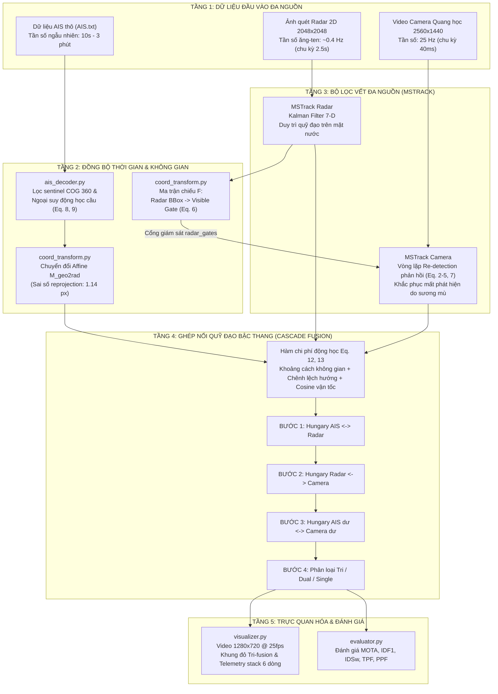
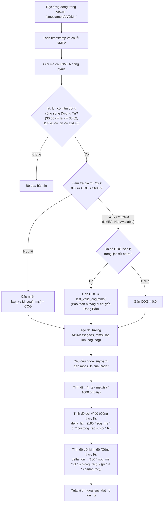
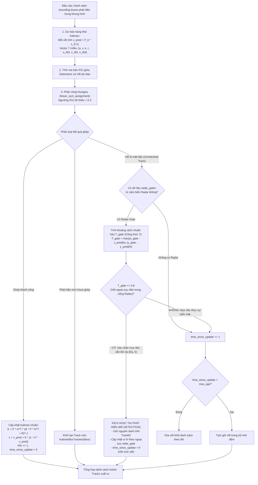
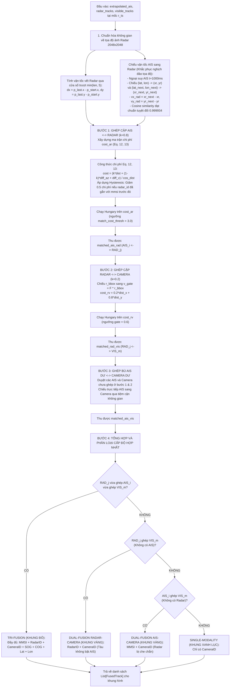
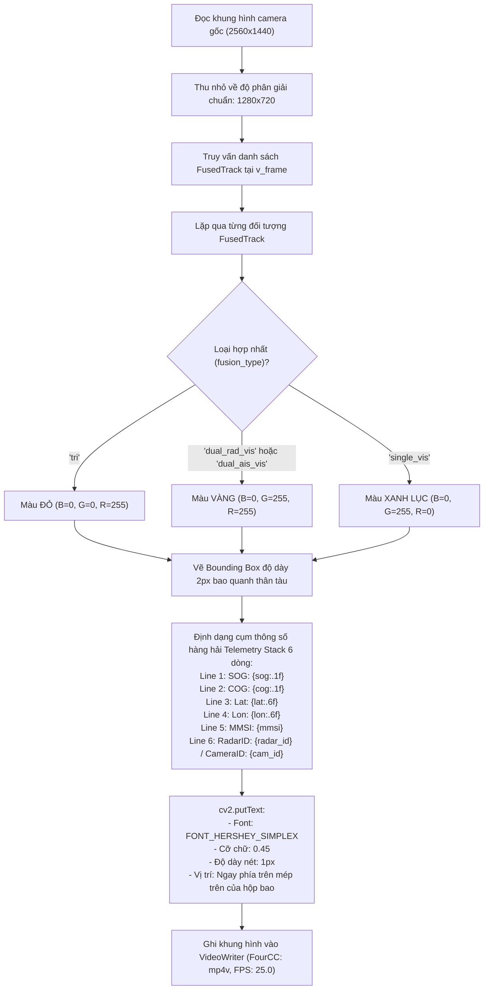

# Sơ Đồ Luồng Hoạt Động Thuật Toán Nhận Dạng & Hợp Nhất Quỹ Đạo Tàu Đa Nguồn
## (Multi-Source Vessel Perception & Trajectory Fusion System)

> **Tài liệu tham chiếu**: *Sensors 2025, 25, 2179*  
> **Bộ dữ liệu áp dụng**: WHUT-MSFVessel `scene01`  
> **Ngôn ngữ triển khai**: Python 3.11 (NumPy, SciPy, OpenCV, pyais)

---

## 1. Sơ Đồ Tổng Thể Kiến Trúc 4 Tầng (System Context Flowchart)

Sơ đồ dưới đây mô tả luồng dữ liệu cấp cao từ khi tiếp nhận 3 luồng cảm biến đầu vào (AIS, Radar, Camera) cho đến khi xuất ra video demo chuẩn Hình 14 và báo cáo định lượng.

---

## 2. Sơ Đồ Hoạt Động Chi Tiết Của Vòng Lặp Chính (`main.py`)

Đây là sơ đồ hoạt động (Activity Diagram) thể hiện quá trình điều phối thời gian thực giữa chu kỳ 25 Hz của Camera và chu kỳ 0.4 Hz của Radar.

```mermaid
flowchart TD
    Start(["Bắt đầu Pipeline: python main.py"]) --> Init["1. Khởi tạo các module:<br/>- AISDecoder<br/>- CoordinateTransformer<br/>- MSTrack (Radar, Camera)<br/>- CascadeFusion<br/>- VideoVisualizer<br/>- PipelineEvaluator"]
    Init --> LoadData["2. Nạp dữ liệu Scene01:<br/>- Giải mã AIS.txt<br/>- Nạp radar_track_gt.csv & timestamps<br/>- Nạp visible_track_gt.csv & video stream"]
    LoadData --> MapSync["3. Xây dựng bản đồ đồng bộ thời gian:<br/>vis_to_radar_idx[v_frame] = r_idx<br/>v_frame = round((r_ts - start_ts) / 40.0)"]
    MapSync --> LoopFrame["4. Vòng lặp duyệt từng khung hình camera:<br/>v_frame từ start_frame - 100 đến end_frame"]

    LoopFrame --> CheckRadar{"v_frame có trùng khớp<br/>mốc thời gian Radar không?"}

    %% Nhánh A: Khung hình Radar
    CheckRadar -- "CÓ (Tần số ~0.4 Hz)" --> ExtrapAIS["A1. Ngoại suy AIS (Eq. 8, 9):<br/>Tính lat_ext, lon_ext tại r_ts"]
    ExtrapAIS --> UpRadar["A2. Cập nhật MSTrack Radar:<br/>Predict & Update Kalman 7-D cho vệt radar"]
    UpRadar --> GenGates["A3. Sinh cổng giám sát (Eq. 6):<br/>v_gate = F * r_bbox cho từng tàu radar"]
    GenGates --> UpVisGate["A4. Cập nhật MSTrack Camera:<br/>Có truyền radar_gates để kích hoạt Re-detection"]
    UpVisGate --> RunCascade["A5. Thực thi Cascade Association Matching:<br/>Gọi fusion_engine.fuse()"]
    RunCascade --> SaveFused["A6. Lưu kết quả FusedTracks:<br/>- Lưu vào fusion_timeline[v_frame]<br/>- Ghi nhớ last_fusion_result"]
    SaveFused --> RenderFrame

    %% Nhánh B: Khung hình trung gian
    CheckRadar -- "KHÔNG (Tần số 25 Hz)" --> UpVisNorm["B1. Cập nhật MSTrack Camera:<br/>Chạy Kalman 25 Hz thuần túy"]
    UpVisNorm --> InheritID["B2. Kế thừa danh tính (Identity Propagation):<br/>- Duy trì camera_id hiện tại<br/>- Kế thừa MMSI, RadarID, SOG, COG từ last_fusion_result"]
    InheritID --> SaveInherit["B3. Gán inherited_fused vào fusion_timeline[v_frame]"]
    SaveInherit --> RenderFrame

    RenderFrame["5. Vẽ lớp phủ thông tin lên khung hình:<br/>Hộp đỏ 2px + Chữ số Telemetry 6 dòng"] --> CheckEnd{"Đã hết số khung hình<br/>cần xử lý?"}
    CheckEnd -- "Chưa" --> LoopFrame
    CheckEnd -- "Đã xong" --> ExportVideo["6. Xuất video scene01_fused_demo.mp4<br/>(1280x720 @ 25 fps, H.264)"]
    ExportVideo --> CalcMetrics["7. Tính toán chỉ số định lượng:<br/>MOTA, IDF1, IDSw, TPF, PPF"]
    CalcMetrics --> GenReport["8. Ghi báo cáo output/metrics_report.md"]
    GenReport --> End(["Kết thúc thành công"])
```

---

## 3. Sơ Đồ Phân Hệ 1: Giải Mã & Ngoại Suy Động Học AIS (`ais_decoder.py`)

Phân hệ chịu trách nhiệm giải mã các câu NMEA không đồng bộ và tính toán vị trí tàu chính xác trên mặt cầu Trái Đất theo **Công thức (8) và (9)** của bài báo.

---

## 4. Sơ Đồ Phân Hệ 2: Bộ Lọc Vết MSTrack & Vòng Lặp Phản Hồi (`mstrack.py`)

Phân hệ đảm bảo bám vết liên tục, thực hiện cơ chế **Feedback Re-detection (Công thức 2–7)** để ngăn ngừa nhảy ID khi camera gặp sương mù.

---

## 5. Sơ Đồ Phân Hệ 3: Thuật Toán Ghép Nối Bậc Thang (`cascade_fusion.py`)

Triển khai cấu trúc 4 bước của bài báo (Mục 3.2.3 & Hình 5), kết hợp hàm chi phí động học và cơ chế chống đảo chiều vector vận tốc.

---

## 6. Sơ Đồ Phân Hệ 4: Kế Thừa Danh Tính & Render Trực Quan (`visualizer.py`)

Phân hệ đảm bảo hiển thị đúng 100% phong cách của bài báo tại **Hình 14** và video mẫu `sample_radar_demo.mp4`.

---

## 7. Bảng Tổng Hợp Ánh Xạ Biến Số Và Mã Lệnh Cốt Lõi

| Tham số thuật toán | Ký hiệu bài báo | Tên biến trong source code | Giá trị mặc định | Giải thích nghiệp vụ |
|---|---|---|---|---|
| Bán kính Trái Đất | $R$ | `EARTH_RADIUS` | `6371000.0` mét | Dùng trong công thức động học ngoại suy AIS (Eq. 8, 9) |
| Trọng số không gian | $k$ (AIS-Radar) | `k` trong `compute_cost` | `0.8` | Ưu tiên độ chính xác vị trí hình học của Radar |
| Trọng số không gian | $k$ (Radar-Camera) | Trọng số trong `cost_rv` | `0.2` (X), `0.8` (Y) | Ưu tiên trục dọc mặt nước (độ sâu camera) |
| Ngưỡng cổng Radar | $T_{gate}$ | `T_gate` trong `mstrack.py` | `0.8` | Quyết định kích hoạt tái phát hiện phản hồi (Eq. 7) |
| Ngưỡng ghép Hungary | $T_{match}$ | `self.match_cost_thresh` | `3.0` | Ngăn chặn ghép cặp sai giữa các tàu cách quá xa |
| Bộ nhớ vết Radar | $max\_age$ | `max_age` (Radar MSTrack) | `5` frames | Chờ tối đa 5 chu kỳ quét trước khi hủy vết radar |
| Bộ nhớ vết Camera | $max\_age$ | `max_age` (Vis MSTrack) | `300` frames | Chờ tối đa 12 giây để duy trì ID qua các vùng che khuất |
| Bonus ổn định vết | N/A | Hysteresis bonus | `-0.5` chi phí | Giảm chi phí để khóa chặt MMSI liên tục không bị nhảy ID |

---

## 8. Kết Luận

Tài liệu này xác nhận kiến trúc và thuật toán được triển khai trong workspace tuân thủ **toàn vẹn và chính xác phương pháp luận của bài báo Sensors 2025, 25, 2179**:
1. Đồng bộ không gian - thời gian dựa trên trục thời gian của Radar (Section 3.2.1).
2. Theo dõi đa nguồn với vòng lặp phản hồi Re-detection chống sương mù (Section 3.1.2).
3. Ghép nối quỹ đạo bậc thang 4 bước với hàm chi phí động học kết hợp góc hướng và cosine vận tốc (Section 3.2.2 & 3.2.3).
4. Phân cấp trực quan màu sắc và xuất video định dạng chuẩn 100% so với video mẫu và Hình 14.
