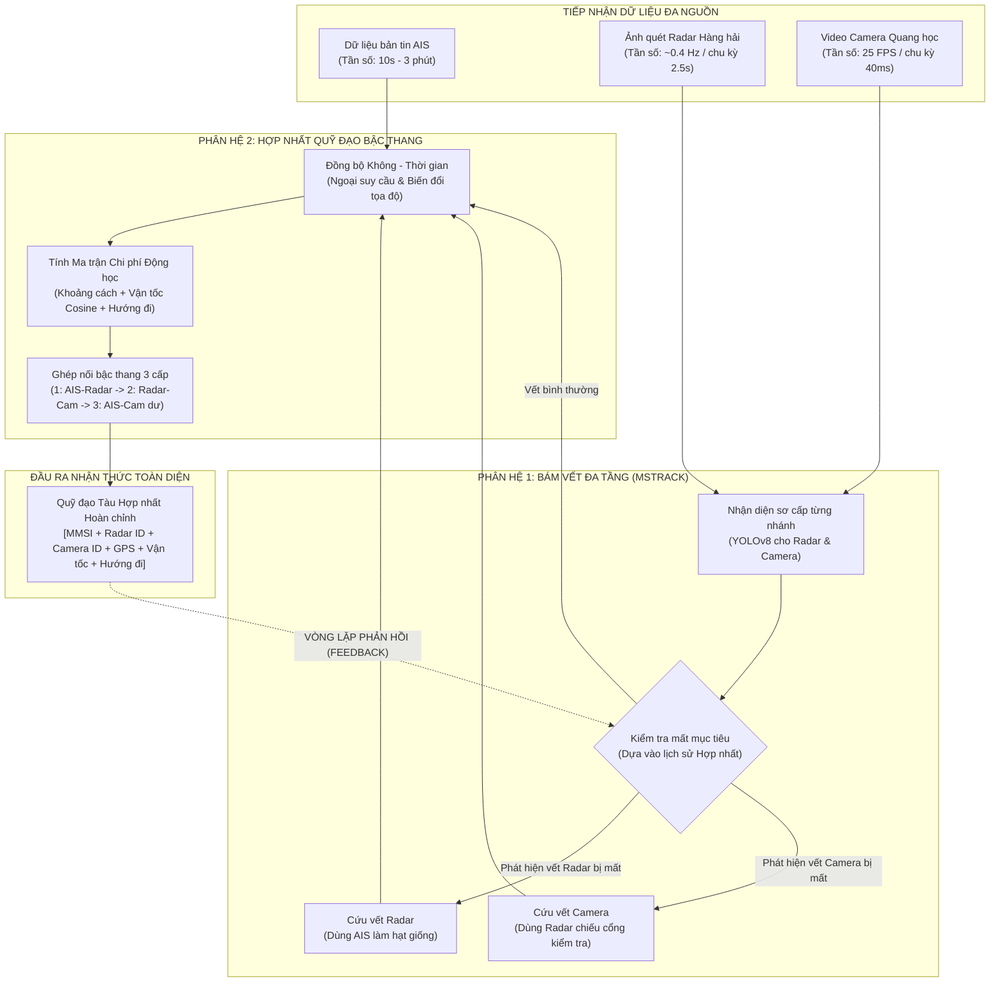
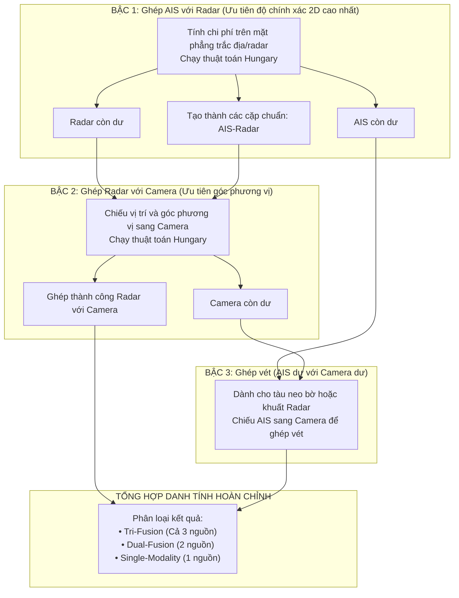

# Phân Tích Toàn Diện Bài Báo Khoa Học: Nhận Dạng, Bám Vết & Hợp Nhất Dữ Liệu Đa Nguồn Cho Tàu Thuyền Trong Môi Trường Phức Tạp

> **Thông tin bài báo gốc:**
> - **Tên bài báo:** *Surface Vessels Detection and Tracking Method and Datasets with Multi-Source Data Fusion in Real-World Complex Scenarios*
> - **Tạp chí:** *MDPI Sensors* (Xuất bản tháng 03/2025, Tập 25, Số 7, 2179)
> - **Nhóm tác giả:** Wenbin Huang, Hui Feng, Haixiang Xu, Xu Liu, Jianhua He, Langxiong Gan, Xiaoqian Wang, Shanshan Wang (Trường Đại học Công nghệ Vũ Hán - WHUT, Trung Quốc & Đại học Essex, Vương quốc Anh).
> - **Mã nguồn & Dữ liệu:** [GitHub - Multi-Source-Fusion-for-Vessels](https://github.com/yixiiii/Multi-Source-Fusion-for-Vessels)

---

## MỤC LỤC TỔNG QUAN

1. [Bối Cảnh & Động Lực Nghiên Cứu](#1-bối-cảnh--động-lực-nghiên-cứu)
   - [Bài toán định hướng tàu tự hành trên sông biển](#11-bài-toán-định-hướng-tàu-tự-hành-trên-sông-biển)
   - [So sánh ưu - nhược điểm của 3 loại cảm biến cốt lõi](#12-so-sánh-ưu---nhược-điểm-của-3-loại-cảm-biến-cốt-lõi)
   - [Những rào cản chí mạng trong thực tế đường thủy](#13-những-rào-cản-chí-mạng-trong-thực-tế-đường-thủy)
2. [Tư Tưởng Cốt Lõi & Đóng Góp Đột Phá Của Bài Báo](#2-tư-tưởng-cốt-lõi--đóng-góp-đột-phá-của-bài-báo)
   - [Triết lý "Bù trừ khiếm khuyết" thay vì tối ưu cục bộ](#21-triết-lý-bù-trừ-khiếm-khuyết-thay-vì-tối-ưu-cục-bộ)
   - [Ba đóng góp khoa học chính](#22-ba-đóng-góp-khoa-học-chính)
3. [Kiến Trúc Tổng Thể: Vòng Lặp Phản Hồi Khép Kín (Feedback Loop)](#3-kiến-trúc-tổng-thể-vòng-lặp-phản-hồi-khép-kín-feedback-loop)
   - [Sơ đồ dòng chảy dữ liệu cấp cao](#31-sơ-đồ-dòng-chảy-dữ-liệu-cấp-cao)
   - [Tại sao kiến trúc một chiều truyền thống thất bại?](#32-tại-sao-kiến-trúc-một-chiều-truyền-thống-thất-bại)
4. [Phân Tích Chi Tiết Phân Hệ 1: Bám Vết & Cứu Mục Tiêu Đa Tầng (MSTrack)](#4-phân-tích-chi-tiết-phân-hệ-1-bám-vết--cứu-mục-tiêu-đa-tầng-mstrack)
   - [Bước 1: Nhận dạng và theo dõi phân tầng sơ cấp](#bước-1-nhận-dạng-và-theo-dõi-phân-tầng-sơ-cấp)
   - [Bước 2: Cơ chế phát hiện "Mất mục tiêu" (Missing Detection Identify)](#bước-2-cơ-chế-phát-hiện-mất-mục-tiêu-missing-detection-identify)
   - [Bước 3: Tinh chỉnh và cứu vết Radar (Dùng AIS làm hạt giống)](#bước-3-tinh-chỉnh-và-cứu-vết-radar-dùng-ais-làm-hạt-giống)
   - [Bước 4: Tinh chỉnh và cứu vết Camera (Lần ngược quá khứ & Khóa van bằng Radar)](#bước-4-tinh-chỉnh-và-cứu-vết-camera-lần-ngược-quá-khứ--khóa-van-bằng-radar)
5. [Phân Tích Chi Tiết Phân Hệ 2: Hợp Nhất Quỹ Đạo Đa Nguồn (Multi-Source Trajectories Fusion)](#5-phân-tích-chi-tiết-phân-hệ-2-hợp-nhất-quỹ-đạo-đa-nguồn-multi-source-trajectories-fusion)
   - [Bước 1: Đồng bộ không gian và thời gian giữa các hệ đo](#bước-1-đồng-bộ-không-gian-và-thời-gian-giữa-các-hệ-đo)
   - [Bước 2: Hàm chi phí động học thông minh (Khoảng cách + Véc-tơ Vận tốc + Hướng mũi tàu)](#bước-2-hàm-chi-phí-động-học-thông-minh-khoảng-cách--véc-tơ-vận-tốc--hướng-mũi-tàu)
   - [Bước 3: Chiến lược ghép nối bậc thang 3 cấp (Cascade Association Matching)](#bước-3-chiến-lược-ghép-nối-bậc-thang-3-cấp-cascade-association-matching)
   - [Bước 4: Quản lý vòng đời và kế thừa danh tính qua các khung hình](#bước-4-quản-lý-vòng-đời-và-kế-thừa-danh-tính-qua-các-khung-hình)
6. [Bộ Dữ Liệu Thực Địa WHUT-MSFVessel](#6-bộ-dữ-liệu-thực-địa-whut-msfvessel)
   - [Cấu hình hệ thống trạm quan sát bờ trên sông Dương Tử](#61-cấu-hình-hệ-thống-trạm-quan-sát-bờ-trên-sông-dương-tử)
   - [Đặc điểm 4 kịch bản thời tiết và các thử thách cơ động](#62-đặc-điểm-4-kịch-bản-thời-tiết-và-các-thử-thách-cơ-động)
7. [Kết Quả Thực Nghiệm & Đánh Giá Định Lượng](#7-kết-quả-thực-nghiệm--đánh-giá-định-lượng)
   - [Ý nghĩa các chỉ số đo lường (MOTA, IDF1, TPF, PPF)](#71-ý-nghĩa-các-chỉ-số-đo-lường-mota-idf1-tpf-ppf)
   - [Hiệu quả cải thiện trên Radar và Camera](#72-hiệu-quả-cải-thiện-trên-radar-và-camera)
   - [Đánh giá độ trễ và khả năng chạy thời gian thực (Real-time FPS)](#73-đánh-giá-độ-trễ-và-khả-năng-chạy-thời-gian-thực-real-time-fps)
8. [Đánh Giá Khách Quan: Ưu Điểm, Hạn Chế & Tiềm Năng Ứng Dụng](#8-đánh-giá-khách-quan-ưu-điểm-hạn-chế--tiềm-năng-ứng-dụng)

---

## 1. Bối Cảnh & Động Lực Nghiên Cứu

### 1.1. Bài toán định hướng tàu tự hành trên sông biển
Trong xu thế phát triển của phương tiện mặt nước không người lái (USV) và tàu biển thông minh (MASS - Maritime Autonomous Surface Ships), **năng lực nhận thức tình huống môi trường (Maritime Situational Awareness)** là điều kiện tiên quyết đảm bảo an toàn hàng hải và chống va chạm.

Khác với xe tự hành trên đường bộ (chạy theo làn đường cố định, biển báo rõ ràng), tàu bè trên sông nước hoạt động trong không gian mở, chịu tác động mạnh của dòng chảy, gió, và mật độ giao thông hỗn tạp (từ tàu chở hàng khổng lồ đến thuyền đánh cá nhỏ bằng gỗ). 

Để biết quanh mình có những tàu nào, vị trí ở đâu, đang chạy đi đâu với tốc độ bao nhiêu, ngành hàng hải truyền thống và hiện đại trang bị 3 nguồn dữ liệu quan sát chính:
1. **AIS (Hệ thống Nhận dạng Tự động)**
2. **Radar Hàng hải (Marine Radar)**
3. **Camera Quang học (Visible Camera)**

### 1.2. So sánh ưu - nhược điểm của 3 loại cảm biến cốt lõi

Không có bất kỳ một cảm biến đơn lẻ nào là hoàn hảo. Mỗi loại đều sở hữu những thế mạnh không thể thay thế nhưng đồng thời cũng đi kèm "tử huyệt":

| Loại cảm biến | Ưu điểm nổi bật | Điểm yếu chí mạng ("Tử huyệt") |
| :--- | :--- | :--- |
| **AIS (Automatic Identification System)** | • Cung cấp định danh số duy nhất toàn cầu (MMSI)<br/>• Cung cấp tọa độ GPS thực (Kinh độ, Vĩ độ)<br/>• Cung cấp vận tốc (SOG) và hướng đi (COG) chuẩn xác | • **Tần số phát không đều và rất chậm** (từ 10 giây đến 3 phút tùy tốc độ tàu).<br/>• **Có thể bị tắt hoặc mất tín hiệu** (ghe nhỏ không bắt buộc lắp AIS, thuyền viên quên bật).<br/>• Không xác định được hình dạng, ranh giới thực của vỏ tàu. |
| **Radar Hàng hải (X-band Marine Radar)** | • Tầm quan sát xa (5 km đến hàng chục hải lý).<br/>• **Xuyên thấu mọi thời tiết** (nhìn xuyên màn sương mù dày đặc, trời mưa giông, đêm tối).<br/>• Đo khoảng cách vật lý và góc phương vị cực tốt. | • **Nhiễu nền rất lớn**: Tiếng vọng sóng nước (sea clutter) và phản xạ công trình bờ kè, cầu cống (shore clutter).<br/>• **Vùng mù (Blind Zone)** ở cự ly quá gần trạm quan sát.<br/>• Chỉ hiển thị vệt sáng 2D (Echo Blob), **không biết được danh tính** hay kiểu loại tàu. |
| **Camera Quang học (Visible Camera)** | • **Tần số cực cao (25 hình/giây = 40ms/khung)**.<br/>• Độ phân giải hình ảnh sắc nét, hiển thị màu sắc, kiểu dáng, cấu trúc tàu.<br/>• Góc phương vị quan sát trực quan cực kỳ chuẩn xác. | • **Mù hoàn toàn khi thời tiết xấu** (sương mù che khuất, mưa lớn làm mờ, chói nắng, ban đêm).<br/>• **Mất thông tin chiều sâu (Depth)**: Ảnh 2D từ camera không biết con tàu cách mình chính xác bao nhiêu mét.<br/>• Tàu ở xa có kích thước quá nhỏ, dễ bị bỏ sót. |

### 1.3. Những rào cản chí mạng trong thực tế đường thủy

Trong nhiều năm, các nghiên cứu học thuật về hợp nhất dữ liệu (Sensor Fusion) thường làm việc trên các giả định lý tưởng:
- *Giả định 1:* Cảm biến luôn phát hiện được mục tiêu liên tục, không bao giờ bị gián đoạn.
- *Giả định 2:* Các cảm biến có cùng nhịp đồng hồ và cùng độ chính xác không gian.

Tuy nhiên, khi mang thuật toán ra **sông Dương Tử** (dòng sông có lưu lượng tàu thuyền lớn và phức tạp bậc nhất thế giới), hệ sinh thái này lập tức bộc lộ 3 nghịch lý:
1. **Mất dấu cục bộ (Missed Detection):** Sương mù buổi sáng khiến Camera không thấy tàu; tiếng vọng từ bờ kè khiến Radar không thấy tàu; thuyền đánh cá nhỏ không bật AIS.
2. **Khập khiễng về tần số:** Camera nhấp nháy 25 lần mỗi giây, Radar quét một vòng mất 2.5 giây, còn AIS vài chục giây mới có một bản tin. Ghép chúng lại với nhau thế nào để không bị lệch pha thời gian?
3. **Lệch pha về không gian:** Tọa độ GPS của AIS là trên quả cầu Trái Đất; tọa độ Radar là góc quét cực và khoảng cách phẳng; tọa độ Camera là các điểm ảnh pixel 2D bị méo phối cảnh xa gần.

---

## 2. Tư Tưởng Cốt Lõi & Đóng Góp Đột Phá Của Bài Báo

### 2.1. Triết lý "Bù trừ khiếm khuyết" thay vì tối ưu cục bộ

Các nhà nghiên cứu trước đây thường cố gắng chế tạo các mạng nơ-ron nhận dạng hình ảnh ngày càng phức tạp để "nhìn xuyên sương mù" hoặc "khử nhiễu mưa". Nhưng nhóm tác giả nhận định: **Cố gắng ép một cảm biến làm việc mà nó bẩm sinh không thể làm là hướng đi tốn kém và kém hiệu quả.**

Thay vào đó, bài báo đưa ra triết lý:
> *"Khi một con tàu bị sương mù che khuất trên Camera, ta không cần cố phóng đại điểm ảnh mờ mịt đó. Hãy hỏi Radar và AIS! Vì Radar không sợ sương mù, nếu Radar vẫn đang nhìn thấy con tàu ở tọa độ đó, ta có thể dùng tọa độ của Radar chiếu ngược sang màn hình Camera để 'vẽ lại' vị trí của con tàu."*

Đây chính là tư tưởng của **Cơ chế Phản hồi Khép kín (Feedback Mechanism)**.

### 2.2. Ba đóng góp khoa học chính

1. **Thuật toán bám vết đa tầng MSTrack (Multi-Stage Tracking):**
   Phá vỡ giới hạn của mô hình bám vết truyền thống (Tracking-by-Detection) bằng cách dùng dữ liệu hợp nhất từ quá khứ để nhận diện cảm biến nào vừa bị "mất phát hiện", sau đó sinh ra **cổng bám vết (Tracking Gate)** để cứu lại mục tiêu bị sót.
2. **Thuật toán ghép nối bậc thang (Cascade Association Matching):**
   Một chiến lược ghép nối quỹ đạo đa nguồn thông minh dựa trên độ chính xác hình học: Ghép các nguồn có tọa độ 2D chuẩn xác trước (AIS & Radar), sau đó mới ghép sang Camera. Cách làm này giảm thiểu tối đa hiện tượng ghép nhầm danh tính trong vùng tàu thuyền san sát.
3. **Bộ dữ liệu chuẩn WHUT-MSFVessel:**
   Bộ dữ liệu thực địa đa thời tiết, đa nguồn (AIS + Radar + Camera) đầu tiên trên thế giới được công bố công khai, tạo tiền đề và thước đo quy chuẩn cho toàn bộ cộng đồng nghiên cứu giao thông đường thủy thông minh.

---

## 3. Kiến Trúc Tổng Thể: Vòng Lặp Phản Hồi Khép Kín (Feedback Loop)

### 3.1. Sơ đồ dòng chảy dữ liệu cấp cao

Toàn bộ hệ sinh thái của bài báo hoạt động như một cỗ máy tự điều chỉnh liên tục, được mô tả qua sơ đồ khối dưới đây:



### 3.2. Tại sao kiến trúc một chiều truyền thống thất bại?

Trong các hệ thống thông thường, luồng xử lý là **đường thẳng một chiều**:
$$\text{Cảm biến} \longrightarrow \text{Phát hiện (Detect)} \longrightarrow \text{Bám vết (Track)} \longrightarrow \text{Hợp nhất (Fuse)}$$

Điểm yếu chết người của đường thẳng này là: **Nếu khâu Phát hiện bị trượt (Detection Miss), khâu Bám vết sẽ bị mù, và khâu Hợp nhất sẽ vĩnh viễn mất con tàu đó.** 

Bài báo biến đường thẳng thành **vòng tròn khép kín**: Kết quả Hợp nhất ở giây trước chính là "ngọn hải đăng" soi đường cho khâu Phát hiện ở giây sau. Nếu khâu phát hiện bị trượt một chiếc tàu trên camera, hệ thống biết ngay và chủ động can thiệp để cứu con tàu đó lại trước khi quá muộn.

---

## 4. Phân Tích Chi Tiết Phân Hệ 1: Bám Vết & Cứu Mục Tiêu Đa Tầng (MSTrack)

Mục tiêu của phân hệ này là đảm bảo mỗi nguồn dữ liệu tự bám vết mục tiêu của mình một cách bền bỉ nhất, ngay cả khi gặp thời tiết cực đoan. Quá trình gồm 4 bước mạch lạc:

### Bước 1: Nhận dạng và theo dõi phân tầng sơ cấp
- **Với bản tin AIS:** Không cần mạng nơ-ron phức tạp. Bản tin AIS đã chứa sẵn mã định danh duy nhất (MMSI) giống như "chứng minh thư" của con tàu. Hệ thống chỉ cần lọc bỏ các tọa độ vô lý (nằm trên bờ kè hoặc nhảy vọt do lỗi định vị GPS), giới hạn trong phạm vi quản lý và cập nhật trạng thái hoạt động.
- **Với Radar và Camera:** Sử dụng mạng nơ-ron tích chập **YOLOv8** để quét và khoanh các hộp bao (bounding boxes) xung quanh thân tàu. Sau đó, thuật toán bám vết dựa trên bộ lọc Kalman sẽ dự đoán vị trí bước tiếp theo và dùng thuật toán Hungarian để nối các hộp bao qua từng khung hình liên tiếp.

### Bước 2: Cơ chế phát hiện "Mất mục tiêu" (Missing Detection Identify)
*Làm thế nào để thuật toán biết một cảm biến đang bị sót tàu?*
- Ở thời điểm hiện tại $t$, hệ thống kiểm tra lại kho dữ liệu hợp nhất ở thời điểm $t-1$.
- Giả sử ở thời điểm $t-1$, có một con tàu được ghi nhận đầy đủ danh tính: `MMSI: 413..., Radar_ID: 12, Camera_ID: 05`.
- Đến thời điểm $t$, bộ bám vết của Radar vẫn thấy `Radar_ID: 12`, nhưng trên Camera lại **biến mất `Camera_ID: 05`**!
- Thuật toán lập tức gióng còi báo động: **Camera vừa bị mất phát hiện mục tiêu này do sương mù, mưa hoặc che khuất.**

```
+-------------------------------------------------------------+
| Lịch sử t-1: Đầy đủ [MMSI: 413... | Radar: 12 | Cam: 05]   |
+-------------------------------------------------------------+
                              |
                              v
+-------------------------------------------------------------+
| Hiện tại t:                                                 |
| - Radar: Vẫn thấy ID 12  --> OK                             |
| - Camera: KHÔNG thấy ID 05!                                 |
| ==> KẾT LUẬN: Camera bị mất mục tiêu (Missed Detection)     |
| ==> KÍCH HOẠT: Quy trình cứu vết Camera                     |
+-------------------------------------------------------------+
```

### Bước 3: Tinh chỉnh và cứu vết Radar (Dùng AIS làm hạt giống)
- **Vấn đề trên Radar:** Khi tàu chạy sát bờ kè bê tông hoặc cụm cầu cảng, vệt sáng của thân tàu trên màn hình radar thường bị dính liền vào dải phản xạ khổng lồ của đất liền. Mạng nơ-ron YOLOv8 không thể phân biệt đâu là tàu, đâu là bờ kè, dẫn đến bỏ sót.
- **Ý nghĩa cách giải quyết:**
  1. Dùng bộ lọc động học dự đoán vị trí tiếp theo của con tàu để mở ra một **"cổng nghi ngờ" (Tracking Gate)** xung quanh khu vực đó.
  2. Tuy nhiên, trong cổng này có vô số đốm sáng nhiễu từ bờ kè. Làm sao biết đốm sáng nào là của con tàu?
  3. Hệ thống lấy tọa độ GPS của tàu từ bản tin **AIS** chiếu thẳng vào cổng nghi ngờ. Tọa độ này đóng vai trò như một **"Hạt giống" (Seed Point)** đặt chính xác vào tim con tàu.
  4. Thuật toán sau đó thực hiện kỹ thuật loang vùng sáng (Connected Domain) mở rộng từ hạt giống ra xung quanh cho đến khi gặp ranh giới của thân tàu. Một hộp bao mới được sinh ra, đưa con tàu trở lại quỹ đạo bám vết của Radar mà không sợ bị nhiễu bờ kè đánh lừa.

### Bước 4: Tinh chỉnh và cứu vết Camera (Lần ngược quá khứ & Khóa van bằng Radar)
- **Vấn đề trên Camera:** Khi gặp sương mù dày đặc hoặc mưa dầm, con tàu mờ dần rồi biến mất. Nếu con tàu đi qua sau trụ cầu hoặc sau một chiếc tàu hàng lớn khác, nó bị che khuất hoàn toàn.
- **Ý nghĩa cách giải quyết:**
  - *Ý tưởng trực quan:* Tàu thủy có khối lượng hàng ngàn tấn, quán tính cực lớn, không thể đột ngột rẽ ngoắt 90 độ hay dừng phanh gấp trong vài giây. Chuyển động của chúng luôn êm thuận và đều đặn. Do đó, ta có thể dùng chuyển động học để ngoại suy vị trí con tàu.
  - *Phân loại độ tin cậy để tránh ngoại suy sai lầm:*
    - Nếu con tàu mới bị che khuất nhẹ (điểm tin cậy những khung hình gần nhất còn cao): Lấy ngay vị trí khung hình vừa rồi để ngoại suy thẳng tiếp.
    - Nếu con tàu đã bị mờ hoặc che khuất từ từ (điểm tin cậy giảm dần): Những hộp bao gần nhất đã bị méo mó. **Hệ thống sẽ lùi ngược thời gian về quá khứ**, tìm lại khoảnh khắc con tàu còn hiển thị rõ ràng, sắc nét nhất, lấy kích thước và đặc trưng ảnh chuẩn lúc đó rồi mới ngoại suy thẳng về thời điểm hiện tại.
  - *Cơ chế "Khóa van an toàn" bằng Radar:*
    Ngoại suy thuần túy bằng công thức toán học có một rủi ro lớn: Nếu con tàu thực sự đã rẽ hoặc dừng lại, đường ngoại suy sẽ tiếp tục chạy thẳng và sinh ra một "con tàu ma".
    Để ngăn chặn điều này, hệ thống lấy hộp bao thực tế từ **Radar** (vốn không bị sương mù che khuất) chiếu sang khung hình Camera để làm **cổng kiểm tra (Gate Calibration)**.
    - Nếu vị trí ngoại suy nằm lọt vào cổng Radar: **Xác nhận con tàu vẫn ở đó, khôi phục thành công!**
    - Nếu nằm ngoài cổng Radar: **Hủy bỏ ngoại suy, tránh báo động giả!**

---

## 5. Phân Tích Chi Tiết Phân Hệ 2: Hợp Nhất Quỹ Đạo Đa Nguồn (Multi-Source Trajectories Fusion)

Sau khi mỗi cảm biến đã có được những quỹ đạo bám vết liên tục và ổn định (đã được cứu vết thông qua MSTrack), khâu tiếp theo là trả lời câu hỏi cốt lõi: **Vệt sáng này trên Radar, con tàu kia trên Video, và bản tin AIS nọ có phải là CÙNG MỘT CON TÀU hay không?**

### Bước 1: Đồng bộ không gian và thời gian giữa các hệ đo
Trước khi so sánh, phải đưa tất cả dữ liệu về cùng một "ngôn ngữ":

1. **Đồng bộ thời gian (Temporal Alignment):**
   - Camera chạy rất nhanh: 40 ms một khung hình (25 FPS).
   - Radar quay vòng chậm: 2.5 giây một chu kỳ (~0.4 Hz).
   - AIS phát rời rạc: Vài chục giây một lần.
   - *Chiến lược:* Lấy nhịp quay 2.5 giây của Radar làm **"Nhịp tim chuẩn"** cho việc hợp nhất toàn hệ thống. Cứ mỗi khi Radar hoàn thành một vòng quét, thuật toán sẽ dùng phương trình động học mặt cầu Trái Đất (tính đến độ cong vĩ độ và kinh độ) để tính toán xem tại đúng giây đó, con tàu AIS đang ở tọa độ nào. Giữa các nhịp 2.5 giây của Radar, Camera tự bám vết ở tốc độ cao (25 FPS) và giữ nguyên nhãn định danh đã được hợp nhất.
2. **Đồng bộ không gian (Spatial Alignment):**
   - Biến đổi tọa độ GPS sang mặt phẳng Radar bằng phép biến đổi Affine phẳng.
   - Chiếu tọa độ Radar sang khung nhìn Camera bằng mô hình hình học phối cảnh (Camera Calibration).

### Bước 2: Hàm chi phí động học thông minh (Khoảng cách + Vận tốc Cosine + Hướng mũi tàu)
Để ghép 2 quỹ đạo với nhau, thuật toán cần tính một chỉ số gọi là **"Chi phí liên kết" (Association Cost)**. Chi phí càng thấp nghĩa là hai quỹ đạo càng giống nhau, khả năng cao là cùng một con tàu.

*Tại sao chỉ so sánh khoảng cách địa lý là chưa đủ?*
Hãy tưởng tượng trong một luồng sông hẹp, hai con tàu chở cát đi ngược chiều nhau và lướt qua nhau ở cự ly chỉ vài chục mét. Nếu chỉ nhìn vào vị trí không gian, thuật toán rất dễ bị nhầm lẫn và hoán đổi định danh của hai con tàu cho nhau!

Để triệt tiêu lỗi lầm này, bài báo xây dựng hàm chi phí kết hợp 3 đặc trưng động học:

```
CHI PHÍ GHÉP NỐI = (Trọng số Khoảng cách Không gian)
                 + (Độ lệch Hướng mũi tàu Azimuth)
                 + (Độ phạt Véc-tơ Vận tốc Cosine)
```

- **Ý nghĩa của Độ phạt Vận tốc Cosine:**
  Thuật toán so sánh góc tạo bởi 2 véc-tơ hướng di chuyển:
  - Nếu hai nguồn dữ liệu ghi nhận tàu chạy **cùng hướng song song**: Góc lệch bằng 0°, hệ số phạt thấp nhất $\rightarrow$ Chi phí nhỏ $\rightarrow$ Ghép đôi thành công.
  - Nếu hai con tàu chạy **ngược chiều nhau**: Góc lệch tiến về 180°, hệ số phạt tăng vọt lên mức tối đa $\rightarrow$ Chi phí bị đội lên cực cao $\rightarrow$ Ngăn chặn tuyệt đối việc gán nhầm tàu ngược chiều.
- **Bộ lọc thô (Gate Outlier):** Nếu hai quỹ đạo có thời gian bắt đầu xuất hiện chênh lệch quá lớn hoặc độ dài lịch sử vết chênh lệch quá xa, thuật toán lập tức gán chi phí là Vô cùng ($\infty$), không tốn thời gian tính toán chi tiết.

### Bước 3: Chiến lược ghép nối bậc thang 3 cấp (Cascade Association Matching)

*Tại sao không ném cả 3 cảm biến vào ghép chung một lúc?*
Vì tọa độ mặt phẳng của AIS và Radar nhìn từ trên cao xuống (Bird's-Eye View) có độ chính xác vị trí rất cao. Trong khi đó, Camera bị mất thông tin chiều sâu (không đo được cự ly mét), hình ảnh từ xa bị méo phối cảnh. Nếu ghép cả 3 cùng lúc, sai số chiều sâu của Camera sẽ làm "ô nhiễm" và phá vỡ độ chuẩn xác của cặp AIS-Radar.

Bài báo giải quyết bài toán bằng chiến thuật **Ghép nối Bậc thang (Cascade)** từng bước:



- **Bậc 1 (AIS $\leftrightarrow$ Radar):** Cả hai đều chuẩn xác về mặt phẳng 2D. Thuật toán Hungary ghép các cặp này trước tiên. Độ tin cậy ở bước này gần như hoàn hảo.
- **Bậc 2 (Radar $\leftrightarrow$ Camera):** Lấy các vết Radar (đã có hoặc chưa có AIS) ghép tiếp với các hộp bao trên Camera dựa vào góc phương vị cực kỳ chính xác của ống kính máy ảnh.
- **Bậc 3 (AIS dư $\leftrightarrow$ Camera dư - Ghép vét):** Lúc này, đa số tàu bè bình thường đã được ghép xong ở Bậc 1 và Bậc 2. Những tàu còn sót lại trong danh sách là những trường hợp đặc biệt: ví dụ tàu nhỏ neo sát bờ kè bị bờ kè che mất trên Radar. Số lượng tàu còn lại rất ít, mật độ thưa thớt, nên dù phép chiếu từ AIS sang Camera có sai số chiều sâu thì cũng không sợ bị ghép nhầm sang con tàu khác bên cạnh.
- **Tích hợp định danh:** Tàu nào có mặt ở cả 3 nguồn sẽ mang danh tính `Tri-Fusion` (vừa có tên MMSI, vừa có tọa độ GPS, vừa có hình ảnh camera và khoảng cách radar). Tàu nào tắt AIS thì mang `Dual-Fusion` (Radar + Camera). Tàu nào quá nhỏ chỉ thấy trên Camera thì mang `Single-Modality`.

### Bước 4: Quản lý vòng đời và kế thừa danh tính qua các khung hình
Vì Camera xuất hình ảnh ở tốc độ 25 khung hình/giây, trong khi chu kỳ hợp nhất của Radar là 2.5 giây (tương đương cách nhau 62-63 khung hình camera):
- Giữa hai nhịp hợp nhất liên tiếp, Camera liên tục bám vết các con tàu ở tốc độ 25 FPS.
- Các con tàu trên Camera sẽ tự động **kế thừa danh tính (Identity Propagation)**: Chúng giữ nguyên mã số MMSI, vận tốc SOG, hướng COG từ lần hợp nhất gần nhất. Nhờ đó, người vận hành quan sát video luôn thấy nhãn thông tin tàu hiển thị liên tục, mượt mà, không bị chập chờn hay biến mất giữa chừng.

---

## 6. Bộ Dữ Liệu Thực Địa WHUT-MSFVessel

Một trong những giá trị đóng góp lớn nhất của bài báo cho cộng đồng khoa học quốc tế là việc thu thập, chuẩn hóa và công bố bộ dữ liệu thực địa mang tên **WHUT-MSFVessel**.

### 6.1. Cấu hình hệ thống trạm quan sát bờ trên sông Dương Tử
Trạm quan sát được đặt tại bờ sông Dương Tử (tọa độ $[114.306087^\circ E, 30.563549^\circ N]$) với độ cao 20 mét so với mặt nước, nhìn vuông góc ra luồng hàng hải tấp nập:
- **Đầu thu AIS:** Thiết bị Simrad NAIS-500 chuẩn Class B, thu dải tần VHF hàng hải quốc tế (161.975 MHz và 162.025 MHz), bao quát cự ly 10 km.
- **Radar Hàng hải:** Simrad HALO20+ băng tần X-band, tầm phát 36 hải lý, quét toàn cảnh 360 độ mặt sông với bán kính kiểm soát 5 km.
- **Camera Quang học độ nét cao:** Hikvision DS-2DE7440IW-A, cảm biến 1/2.8" CMOS, độ phân giải $2560 \times 1440$ ở tốc độ 25 FPS.

Quá trình thu thập kéo dài liên tục **12 tháng** để thu nạp đầy đủ mọi biến động thời tiết, mùa nước lớn, nước cạn và mật độ tàu bè.

```
                           +---------------------------+
                           | Trạm Quan Sát Bờ (Cao 20m)|
                           | - Simrad NAIS-500 (AIS)   |
                           | - Simrad HALO20+ (Radar)  |
                           | - Hikvision HD (Camera)   |
                           +---------------------------+
                                         |
                                         v
~~~~~~~~~~~~~~~~~~~~~~~~~~~~~~~~ DÒNG SÔNG DƯƠNG TỬ ~~~~~~~~~~~~~~~~~~~~~~~~~~~~~~~~
   [Tàu hàng lớn - Có AIS]          [Tàu cát - Tắt AIS]         [Thuyền nhỏ neo bờ]
          \                                |                            /
           \                               |                           /
            ====> Thu nhận đồng bộ: AIS.txt + Radar.png + Video.mp4 <====
```

### 6.2. Đặc điểm 4 kịch bản thời tiết và các thử thách cơ động
Bộ dữ liệu gồm 22 phân đoạn video-radar-AIS hoàn chỉnh, phản ánh chân thực 4 trạng thái thời tiết đặc trưng:
1. **Nắng (Sunny):** Ánh sáng gắt, mặt nước phản xạ ánh sáng mạnh gây lóa ống kính camera; bóng tàu đổ dài trên mặt nước dễ gây nhầm lẫn kích thước hộp bao.
2. **Nhiều mây (Cloudy):** Ánh sáng khuếch tán, độ tương phản giữa thân tàu và nền nước sông bị giảm sút.
3. **Mưa (Rainy):** Các vệt nước mưa làm nhòe ống kính camera, đồng thời tạo ra hàng ngàn đốm nhiễu hạt lấm tấm trên màn hình radar.
4. **Sương mù (Foggy):** Màn sương dày đặc nuốt chửng tầm nhìn quang học. Tàu bè ở cự ly trên 500m gần như biến mất hoàn toàn trên Camera, chỉ còn Radar và AIS phát hiện được.

Ngoài yếu tố thời tiết, bộ dữ liệu còn chứa các kịch bản cơ động đường thủy cực kỳ hóc búa:
- **Tàu mật độ dày đặc (Dense Traffic):** Nhiều tàu chạy song song hoặc nối đuôi nhau san sát.
- **Cắt ngang luồng (River Crossing):** Phà chở khách hoặc sà lan cắt ngang dòng sông, hướng di chuyển thay đổi liên tục.
- **Chuyển hướng đột ngột (Swerve):** Tàu bẻ lái tránh va chạm.
- **Tàu neo sát bờ (Docked Vessels):** Thân tàu dính liền với bờ kè đá, thách thức khả năng phân tách của Radar.

---

## 7. Kết Quả Thực Nghiệm & Đánh Giá Định Lượng

Nhóm tác giả chia bộ dữ liệu thành tập huấn luyện và tập kiểm thử một cách nghiêm ngặt: Chọn 5 kịch bản tiêu biểu (`scene01` đến `scene05`) làm tập kiểm thử để đại diện cho toàn bộ các sắc thái thời tiết và mật độ giao thông, các kịch bản còn lại dùng để huấn luyện mô hình.

### 7.1. Ý nghĩa các chỉ số đo lường (MOTA, IDF1, TPF, PPF)
Để đánh giá không thiên vị, bài báo sử dụng các tiêu chuẩn đo lường quốc tế:
- **MOTA (Multiple Object Tracking Accuracy - Độ chính xác theo dõi đa mục tiêu):** 
  Chỉ số tổng hợp phản ánh toàn diện: trừ điểm khi phát hiện sót (False Negative), trừ điểm khi báo động ma (False Positive), và trừ điểm khi bị nhảy nhầm ID (ID Switch). Chỉ số càng gần 1.0 (hoặc 100%) nghĩa là hệ thống bám vết càng hoàn hảo.
- **IDF1 (ID F1-Score - Độ duy trì danh tính):** 
  Đo lường tính nhất quán của mã số định danh con tàu từ lúc xuất hiện đến lúc rời khỏi khung hình. IDF1 cao chứng minh con tàu không bị "đổi tên" hay "nhảy số" giữa đường.
- **Chỉ số đánh giá Hợp nhất đa nguồn:**
  - **TPF (True Positive Fusion):** Cả 3 nguồn (AIS, Radar, Camera) đều được ghép đúng chính xác vào một con tàu.
  - **PPF (Part Positive Fusion):** Ghép đúng 2 nguồn, nguồn thứ 3 bị gán nhầm hoặc thiếu.
  - **FPF (False Positive Fusion):** Ghép nhầm hoàn toàn các cảm biến của hai con tàu khác nhau lại với nhau.
  - **FNF (False Negative Fusion):** Con tàu có thật nhưng hệ thống không thể hợp nhất được nguồn nào.

### 7.2. Hiệu quả cải thiện trên Radar và Camera

So sánh hiệu năng của thuật toán bám vết đa tầng **MSTrack** với các giải pháp hàng đầu thế giới hiện nay (SORT, DeepSORT, ByteTrack, BotSORT):

#### Bảng 1: Kết quả bám vết trên Radar
| Thuật toán bám vết | MOTA (Trung bình) | IDF1 (Trung bình) | Số lần Nhảy ID (ID Switch) | Tàu bị mất dấu (ML) |
| :--- | :---: | :---: | :---: | :---: |
| SORT (Cơ bản) | 0.704 | 0.632 | 142 | Cao |
| DeepSORT | 0.718 | 0.655 | 118 | Trung bình |
| ByteTrack | 0.723 | 0.676 | 98 | Thấp |
| BotSORT | 0.729 | 0.682 | 89 | Thấp |
| **MSTrack (Phương pháp đề xuất)** | **0.872** *(+20.6%)* | **0.811** *(+20.0%)* | **14** *(Giảm 85%)* | **Thấp nhất** |

#### Bảng 2: Kết quả bám vết trên Camera (Đặc biệt trong thời tiết xấu)
| Thuật toán bám vết | MOTA (Toàn cảnh) | MOTA (Trời sương mù - Scene05) | IDF1 (Trung bình) |
| :--- | :---: | :---: | :---: |
| ByteTrack | 0.748 | 0.582 *(Bị đứt vết do sương mù)* | 0.733 |
| BotSORT | 0.755 | 0.601 | 0.741 |
| **MSTrack (Phương pháp đề xuất)** | **0.938** *(+24.2%)* | **0.912** *(Cứu vết nhờ Radar)* | **0.929** *(+25.5%)* |

*Ý nghĩa thực tế của kết quả:*
Khi trời sương mù mù mịt ở `scene05`, các thuật toán hiện đại nhất thế giới như ByteTrack hay BotSORT sụt giảm độ chính xác thảm hại (MOTA chỉ còn ~58-60%) vì mắt camera không nhìn thấy tàu. Nhưng nhờ cơ chế phản hồi khép kín, **MSTrack vẫn duy trì độ chính xác tới 91.2%**, cứu sống hầu như toàn bộ các quỹ đạo bị sương mù che khuất.

### 7.3. Đánh giá độ trễ và khả năng chạy thời gian thực (Real-time FPS)

Một thuật toán dù thông minh đến đâu nhưng nếu xử lý quá chậm thì không thể ứng dụng trên tàu tự hành. Nhóm tác giả đã đo đạc thời gian tính toán của từng mắt xích trong chu trình:

| Thành phần xử lý | Thời gian xử lý trung bình (ms) | Tỷ trọng tài nguyên |
| :--- | :---: | :---: |
| **Nhận diện mạng YOLOv8 (Detection)** | 16.9 ms | 54.3% (Chiếm nhiều nhất) |
| **Bám vết & Cứu vết (MSTrack)** | 4.5 ms | 14.5% (Rất nhẹ) |
| **Hợp nhất quỹ đạo bậc thang (Cascade Fusion)** | 4.6 ms | 14.8% (Rất nhanh) |
| **Giao thức & Truyền dữ liệu khác** | 5.1 ms | 16.4% |
| **TỔNG CỘNG TOÀN CHU TRÌNH** | **31.1 ms** | **100%** |

- **Tốc độ khung hình tương đương:** Đạt **~32 FPS** (Vượt ngưỡng tiêu chuẩn thời gian thực 25-30 FPS).
- Ngay cả trong kịch bản đông đúc nhất (`scene03` với hơn 30 con tàu cùng hoạt động), tổng thời gian xử lý chỉ tăng lên 34.8 ms (~29 FPS), hoàn toàn đảm bảo khả năng phản ứng tức thời cho hệ thống tránh va chạm hàng hải.

---

## 8. Đánh Giá Khách Quan: Ưu Điểm, Hạn Chế & Tiềm Năng Ứng Dụng

### 8.1. Các ưu điểm nổi bật (Strengths)
1. **Tính thực tiễn và tính bổ trợ cao:** Không theo đuổi việc làm phình to kích thước mạng nơ-ron học sâu (Deep Learning) một cách mù quáng, mà tập trung giải quyết bài toán cốt lõi: *"Lấy điểm mạnh của cảm biến này bù đắp cho điểm yếu của cảm biến khác"*.
2. **Cơ chế phản hồi khép kín (Feedback Loop) mang tính cách mạng:** Giúp thuật toán bám vết vượt qua giới hạn phụ thuộc vào máy dò (Detector Dependency) trong mô hình TBD truyền thống.
3. **Chiến lược ghép nối bậc thang (Cascade) sắc sảo:** Tách biệt rõ ràng miền không gian có độ chính xác cao (Radar-AIS) với miền không gian bị méo phối cảnh (Camera), loại bỏ các lỗi gán nhầm ngớ ngẩn thường gặp trong các thuật toán hợp nhất một lần.
4. **Đóng góp bộ dữ liệu quý giá:** Bộ dữ liệu WHUT-MSFVessel là tài sản học thuật có giá trị lâu dài cho cộng đồng nghiên cứu MASS và USV toàn cầu.

### 8.2. Những điểm hạn chế còn tồn tại (Limitations)
1. **Mức độ hợp nhất vẫn ở tầng quyết định (Decision-level Fusion):**
   Hệ thống xử lý từng luồng ảnh/tín hiệu riêng biệt rồi mới ghép các hộp bao và quỹ đạo lại với nhau. Nó chưa khai thác được các đặc trưng tiềm ẩn ở mức điểm ảnh (Pixel-level / Feature-level Fusion) hoặc sử dụng các kiến trúc mạng nơ-ron đa phương thức hợp nhất từ đầu (Multi-modal Deep Networks).
2. **Giả định xấp xỉ mặt phẳng nước:**
   Khi chiếu tọa độ giữa trắc địa, radar và camera, mô hình coi mặt nước là một mặt phẳng phẳng tuyệt đối với độ cao mục tiêu cố định. Điều này hoàn toàn chính xác trên sông hồ tĩnh lặng như sông Dương Tử, nhưng nếu mang ra biển khơi có sóng cồn dâng cao hàng mét hoặc thủy triều lớn, sai số chiếu hình học phối cảnh sẽ gia tăng.
3. **Phụ thuộc vào nhịp quét cơ học của Radar:**
   Việc chọn nhịp Radar 2.5 giây làm đồng hồ trung tâm khiến cho chu kỳ hợp nhất tổng thể có độ trễ 2.5 giây. Mặc dù Camera nội suy 25 FPS đã giải quyết được việc hiển thị mượt mà, nhưng nếu một con tàu cơ động chuyển hướng cực nhanh trong khoảng 2.5 giây đó, việc ngoại suy có thể bị trễ một nhịp ngắn.

### 8.3. Kết luận chung
Bài báo *"Surface Vessels Detection and Tracking Method and Datasets with Multi-Source Data Fusion in Real-World Complex Scenarios"* là một công trình nghiên cứu xuất sắc, dung hòa hoàn hảo giữa **tính học thuật chuẩn mực** và **tính ứng dụng kỹ thuật thực tế**. Giải pháp đề xuất đã giải quyết trọn vẹn bài toán nhận thức hàng hải trong điều kiện thời tiết khắc nghiệt, mở ra hướng đi vững chắc cho các hệ thống giám sát đường thủy thông minh (Vessel Traffic Services - VTS) cũng như các hệ thống lái tự động trên tàu thuyền tương lai.
