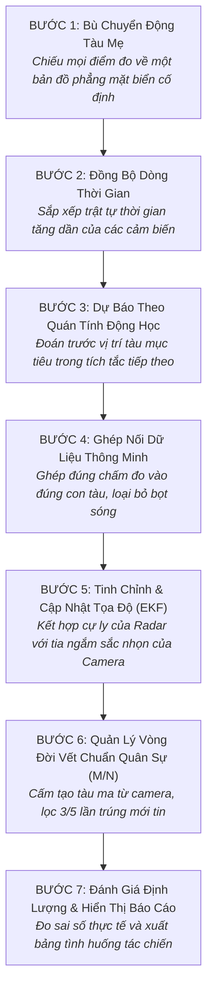

# Tổng Quan Ý Tưởng Triển Khai & Luồng Hoạt Động Phân Hệ Hợp Nhất Động Học Tàu Chiến (Naval Fusion System)

> **Tài Liệu Dành Cho**: Kỹ sư hệ thống, Chỉ huy tác chiến, và Nhà phát triển muốn nắm bắt bản chất nghiệp vụ  
> **Phong Cách Trình Bày**: Trực quan, dễ hiểu, tập trung vào bản chất bài toán và ý nghĩa thực tế của từng bước, không sa đà vào công thức toán học phức tạp.

---

## 1. Bối Cảnh & Tại Sao Phải Xây Dựng Hệ Thống Này?

### 1.1 Khác Biệt Căn Bản Giữa Bài Toán Dân Sự Ven Sông Và Tác Chiến Hải Quân
- **Trong giao thông dân sự (Sông ngòi):** Trạm quan sát được đặt cố định trên bờ kè, tàu thuyền dân sự luôn bật thiết bị định danh hành trình (AIS) một cách tự nguyện, tốc độ di chuyển chậm, không gian hẹp và không có yếu tố thù địch hay cơ động né tránh.
- **Trong tác chiến hải quân (Mặt biển rộng lớn):**
  - **Tàu mẹ liên tục di chuyển và rung lắc:** Bản thân tàu chiến mang hệ thống cảm biến đang cơ động trên sóng to gió lớn (nghiêng ngang Roll, chúc ngẩng Pitch, xoay hướng Yaw). Mọi khoảng cách, góc nhìn đo được từ cảm biến gắn trên boong đều bị sai lệch nếu không được bù trừ chính xác chuyển động của chính con tàu mẹ.
  - **Mục tiêu quân sự cơ động, tắt AIS, ngụy trang:** Tàu chiến địch, xuồng cảm tử không người lái (USV) không bao giờ phát tín hiệu vị trí AIS. Chúng di chuyển ngoắt ngoéo, tăng tốc đột ngột, ngụy trang hoặc lẩn khuất trong nhiễu sóng biển.
  - **Môi trường biển khắc nghiệt:** Sương mù dày đặc trên biển, mưa bão, đêm tối mịt mù khiến mắt thường và camera quang học thông thường hoàn toàn bị vô hiệu hóa.

---

### 1.2 Điểm Mạnh & Điểm Yếu Của Từng Loại Cảm Biến Trên Tàu Chiến

Không có bất kỳ một loại cảm biến đơn lẻ nào là hoàn hảo. Mỗi loại cảm biến chỉ nhìn thấy một phần của sự thật:

```
┌─────────────────────────────────────────────────────────────────────────────┐
│ 1. RADAR HÀNG HẢI (Marine Radar 360°)                                       │
│    [+] Ưu điểm: Tầm quét cực xa (hàng chục hải lý), xuyên mây, sương mù, mưa│
│    [-] Nhược điểm: Tốc độ quét chậm (1-2 giây/vòng), độ phân giải góc kém,  │
│        dễ bị nhiễu sóng biển (sea clutter) tạo ra hàng loạt chấm đo giả.    │
├─────────────────────────────────────────────────────────────────────────────┤
│ 2. LIDAR 3D QUÉT TIA LASER                                                  │
│    [+] Ưu điểm: Đo cự ly và kích thước tàu cực kỳ chính xác (từng centimet).│
│    [-] Nhược điểm: Tầm đo ngắn (dưới 500m), bị mù hoàn toàn khi sương mù dày│
│        hoặc mưa bão lớn do tia laser bị tán xạ nước.                         │
├─────────────────────────────────────────────────────────────────────────────┤
│ 3. CAMERA ẢNH NHIỆT HỒNG NGOẠI (Thermal IR Camera)                          │
│    [+] Ưu điểm: Nhìn xuyên bóng đêm, phát hiện khói động cơ, thân vỏ phát   │
│        nhiệt của tàu cực kỳ nhạy, tốc độ khung hình cao.                    │
│    [-] Nhược điểm: Chỉ cho biết HƯỚNG (Góc phương vị), hoàn toàn KHÔNG BIẾT │
│        mục tiêu ở xa 500m hay xa 5km.                                       │
├─────────────────────────────────────────────────────────────────────────────┤
│ 4. CAMERA QUANG ĐIỆN TỬ BAN NGÀY (EO Visual Camera)                         │
│    [+] Ưu điểm: Hình ảnh sắc nét, phân biệt rõ màu sắc, loại tàu ban ngày.  │
│    [-] Nhược điểm: Mù hoàn toàn vào ban đêm, và cũng CHỈ BIẾT GÓC, KHÔNG CỰ LY.│
└─────────────────────────────────────────────────────────────────────────────┘
```

---

### 1.3 Ý Tưởng Cốt Lõi Của Dự Án (The Big Idea)

> **Ý tưởng lớn nhất**: Hợp nhất điểm mạnh của các cảm biến dị thể lại với nhau:
> - Lấy **cự ly xa và xuyên sương mù** của **Radar**.
> - Lấy **độ chính xác cự ly từng mét** của **LiDAR** ở cự ly gần.
> - Lấy **đường ngắm góc phương vị sắc bén** của **Camera hồng ngoại (IR)** và **quang học (EO)** để gọt giũa độ nhòe góc của Radar.
>
> Kết quả tạo ra một **bức tranh tình huống mặt biển duy nhất (Recognized Maritime Picture - RMP)**: bám bắt liên tục 100% thời gian, vị trí mục tiêu mịn màng, vận tốc chính xác, và tuyệt đối không bị đánh lừa bởi đốm sóng hay vết ma giả mạo.

---

## 2. Ý Nghĩa Của 7 Bước Xử Lý Trong Luồng Hoạt Động

Dưới đây là hành trình của một điểm đo cảm biến từ khi được thu nhận đến khi biến thành một vệt tàu chiến rõ nét trên màn hình chỉ huy:



---

### Bước 1: Bù Chuyển Động Tàu Mẹ (Ownship Motion Compensation)
- **Vấn đề thực tế**: 
  Tàu mẹ đang lướt sóng về phía trước với tốc độ 15 hải lý/giờ và đang ngoặt lái sang phải. Radar phát hiện một chấm phản xạ phía mũi tàu. Nếu ta chỉ nhìn thô trên màn hình cảm biến, chấm này dường như đang lao thẳng về phía mình. Nhưng thực chất con tàu đó đang thả neo đứng yên, ảo giác chuyển động là do chính tàu mẹ tạo ra!
- **Ý nghĩa & Cách giải quyết**:
  Hệ thống sử dụng dữ liệu định vị vệ tinh GNSS và la bàn con quay hồi chuyển INS trên tàu mẹ để **trừ đi chuyển động của chính mình**. Mọi chấm đo thu được từ Radar, LiDAR hay góc nhìn Camera ngay lập tức được quy đổi về **Hệ tọa độ phẳng mặt biển cố định (Piren NED)**:
  - Trục Bắc (North): Đo khoảng cách thực tế mét về phía Cực Bắc.
  - Trục Đông (East): Đo khoảng cách thực tế mét về phía Đông.
  👉 *Nhờ bước này, vị trí của các tàu mục tiêu được "đóng đinh" trên mặt biển thực tế, không còn bị phụ thuộc vào việc tàu mẹ lắc lư hay đổi hướng.*

---

### Bước 2: Đồng Bộ Dòng Thời Gian (Temporal Synchronization)
- **Vấn đề thực tế**:
  Các cảm biến hoạt động với nhịp điệu hoàn toàn khác nhau: Radar quét 1 vòng mất 1.5 giây, Camera hồng ngoại phát hình ảnh 25 khung hình/giây (40 phần nghìn giây), LiDAR quét 10 lần/giây. Dữ liệu đến dồn dập, xen kẽ nhau.
- **Ý nghĩa & Cách giải quyết**:
  Hệ thống đóng vai trò như một "nhạc trưởng", gom tất cả các điểm đo vào một dòng thời gian chung, sắp xếp theo thứ tự thời gian tăng dần nghiêm ngặt.
  Khi bước sang một mốc thời gian mới $t_k$, hệ thống tính ngay khoảng thời gian chênh lệch $\Delta t = t_k - t_{\text{trước}}$ để làm căn cứ cho việc dự báo chuyển động tiếp theo.

---

### Bước 3: Dự Báo Theo Quán Tính Động Học (EKF State Prediction)
- **Vấn đề thực tế**:
  Tàu thuyền trên biển có khối lượng hàng chục đến hàng nghìn tấn. Theo định luật quán tính vật lý, một con tàu không thể nào đột ngột biến mất hoặc nhảy vọt sang vị trí khác cách đó hàng trăm mét chỉ sau 1 giây.
- **Ý nghĩa & Cách giải quyết**:
  Đối với mỗi con tàu đang theo dõi, hệ thống ghi nhớ: **Vị trí hiện tại** và **Vận tốc hiện tại** (Vector 4 chiều $[p_N, p_E, v_N, v_E]$).
  Trước khi nhìn vào điểm đo mới của cảm biến, hệ thống tự động làm một phép suy luận:
  > *"Dựa vào hướng đi và vận tốc của chu kỳ trước, sau $\Delta t$ giây nữa, con tàu này chắc chắn phải đang nằm ở tọa độ dự kiến $(p_{\text{dự kiến}}, v_{\text{dự kiến}})$!"*
  Đồng thời, hệ thống cũng ước lượng một "đám mây sai số" (Elip xác suất) xung quanh vị trí dự kiến đó.

---

### Bước 4: Ghép Nối Dữ Liệu Thông Minh (Data Association)
- **Vấn đề thực tế**:
  Trên màn hình radar có thể xuất hiện 10 chấm phản xạ: 2 chấm là tàu thật, 8 chấm còn lại là bọt sóng biển, chim biển, hoặc phao tiêu. Mặt khác, có 2 tàu chiến đang di chuyển giao cắt nhau. Chấm đo nào là của tàu A? Chấm đo nào của tàu B? Chấm nào là rác?
- **Ý nghĩa & Cách giải quyết (Bộ lọc 3 tầng thông minh)**:
  1. **Vòng kiểm soát an toàn (Mahalanobis Gating):** Vẽ một elip xung quanh vị trí dự kiến của từng tàu dựa trên sai số của cảm biến. Bất kỳ chấm đo nào nằm ngoài elip này sẽ bị loại bỏ ngay lập tức (coi là nhiễu rác).
  2. **Phạt ngược hướng di chuyển (Cosine Heading Penalty):** Nếu một con tàu đang di chuyển về hướng Bắc với tốc độ cao, nhưng có một chấm đo mới lại nằm lùi về phía Nam, dù chấm đó nằm sát tàu cũng sẽ bị "phạt điểm hợp lý" rất nặng. Điều này giúp hệ thống không bao giờ bị bắt nhầm giữa hai con tàu đang chạy ngược chiều nhau.
  3. **Thuật toán ghép cặp toàn cục tối ưu (Hungarian Algorithm):** Thay vì tham lam ghép bừa chấm gần nhất cho tàu đầu tiên, thuật toán Hungary xem xét toàn bộ các tàu và các chấm đo cùng lúc để tìm ra phương án bắt cặp có tổng độ hợp lý cao nhất cho toàn hạm đội.

---

### Bước 5: Tinh Chỉnh & Cập Nhật Tọa Độ (Dual-Mode EKF Update)
- **Vấn đề thực tế**:
  Cảm biến đo có sai số, dự báo quán tính cũng có sai số. Tin vào bên nào hơn? Đặc biệt, làm sao dung hòa giữa cảm biến có cự ly (Radar) và cảm biến chỉ có góc (Camera)?
- **Ý nghĩa & Cách giải quyết**:
  Hệ thống sử dụng cơ chế **Cập nhật hai chế độ linh hoạt**:
  - **Khi nhận được điểm đo 2D từ Radar hoặc LiDAR:** Bộ lọc so sánh vị trí đo được với vị trí dự kiến. Hệ số Kalman đóng vai trò như một "cán cân công lý": nếu cảm biến có độ tin cậy cao (LiDAR), cán cân nghiêng về cảm biến; nếu cảm biến bị nhiễu (Radar), cán cân nghiêng về quán tính. Kết quả cho ra một vị trí trung hòa tối ưu nhất.
  - **Khi nhận được tia ngắm 1D từ Camera hồng ngoại (IR):** Camera không biết cự ly, nhưng góc ngắm cực kỳ chính xác. Bộ lọc EKF dùng đạo hàm hình học (Ma trận Jacobi) để chiếu tia ngắm này vào elip sai số của tàu. Nó giống như việc dùng một con dao sắc gọt bớt độ nhòe góc của radar, giúp vị trí của tàu trên tia ngắm trở nên thanh thoát và sắc nét hơn, trong khi vẫn bảo toàn nguyên vẹn ước lượng cự ly của Radar.
  👉 *Nhờ đó, khi tàu đi vào ban đêm, dù radar bị nhiễu sóng biển, camera nhiệt vẫn "ghim chặt" hướng đi của tàu, giúp đường bám vết thẳng thớm và không bị rung giật.*

---

### Bước 6: Quản Lý Vòng Đời Vết Chuẩn Quân Sự (Military M/N Track Lifecycle)
- **Vấn đề thực tế**:
  Trong tác chiến, báo động nhầm (False Alarm) nguy hiểm không kém gì bỏ lọt mục tiêu. Nếu chỉ vì một đốm sáng lóe lên trên biển mà hệ thống tự động chỉ thị vũ khí bắn hỏa lực thì sẽ gây ra thảm họa tiêu hao đạn dược và lộ vị trí tàu mẹ.
- **Ý nghĩa & Quy tắc quân sự 3 bước**:
  1. **NGUYÊN TẮC BẮT BUỘC: Cấm cảm biến góc tạo vết mới!**
     - Camera hồng ngoại hay quang học chỉ đo được một đường thẳng phương vị kéo dài vô tận ra chân trời. Nếu cho phép nó tạo vết, hệ thống sẽ sinh ra hàng trăm "tàu ma" (Ghost Tracks) dọc theo tia nhìn.
     - Chỉ có cảm biến đo được cự ly 2D (Radar hoặc LiDAR) mới được phép tạo hồ sơ một mục tiêu mới.
  2. **Quy tắc thử thách cửa sổ trượt $M/N$ (3/5):**
     - Khi một chấm đo mới xuất hiện, hệ thống chỉ gắn mác là "Kẻ đáng ngờ" (Tentative).
     - Mục tiêu đáng ngờ này phải tiếp tục xuất hiện và được ghép nối thành công **ít nhất 3 lần trong 5 chu kỳ quét liên tiếp** ($3/5$) thì hệ thống mới chính thức thăng cấp thành "Tàu mục tiêu xác nhận" (Confirmed) và hiển thị lên màn hình chiến thuật cho người chỉ huy.
  3. **Chạy quán tính khi mất dấu (Coasting) & Khai tử vết chết (Purge):**
     - Khi mục tiêu đi vào vùng mù radar hoặc bị che khuất sau làn khói ngụy trang, hệ thống không vội xóa vết mà giữ nó ở chế độ "chạy quán tính" (Coasting), tiếp tục dự đoán vị trí của nó theo vận tốc cũ.
     - Chỉ khi mục tiêu **mất tích liên tiếp quá 5 chu kỳ quét** (hoặc quá 5 giây), hệ thống mới kết luận mục tiêu đã chìm hoặc rời khỏi tầm quan sát và tiến hành xóa bỏ hoàn toàn (Deleted).

---

### Bước 7: Đánh Giá Định Lượng & Báo Cáo Hiệu Năng
- **Ý nghĩa**:
  Hệ thống đối chiếu toàn bộ lịch sử các tàu đã bám bắt với dữ liệu vị trí GPS thực tế (Ground Truth) để xuất ra các chỉ số khách quan:
  - **Sai số vị trí (RMSE Position):** Trung bình vị trí trên màn hình lệch bao nhiêu mét so với con tàu thực tế ngoài đời.
  - **Sai số vận tốc (RMSE Velocity):** Đo tốc độ tàu chạy lệch bao nhiêu mét/giây.
  - **Tỷ lệ bám vết liên tục (Mostly Tracked Ratio):** Mục tiêu có bị đứt quãng giữa chừng không, có theo sát hành trình từ đầu đến cuối không.
  - **Số lần tráo đổi định danh (ID Switches):** Có bị nhầm lẫn định danh giữa tàu này với tàu khác khi đi ngang qua nhau hay không.

---

## 3. Sơ Đồ Trực Quan Dễ Hiểu Về Toàn Bộ Quá Trình

Dưới đây là sơ đồ dòng chảy dữ liệu trực quan:

```
[Các Cảm Biến Trên Tàu Mẹ]
  ├── Marine Radar (360°) ──> [Đo cự ly xa, xuyên sương mù] ────────┐
  ├── LiDAR (Tia Laser)   ──> [Đo cự ly gần cực nét]                 ├──> [BƯỚC 1: Bù chuyển động tàu mẹ]
  ├── Camera Nhiệt (IR)   ──> [Nhìn xuyên đêm, đo góc cực nhạy]     │           (Đưa về bản đồ biển phẳng NED)
  └── Camera Quang học(EO)──> [Nhận dạng màu sắc, góc ban ngày]────┘                         │
                                                                                             ▼
                                                                           [BƯỚC 2: Xếp hàng thời gian]
                                                                                             │
                                                                                             ▼
┌────────────────── VÒNG LẶP CHO TỪNG GIÂY TÁC CHIẾN ──────────────────┐                     │
│                                                                       │                     │
│   [Vết tàu cũ từ giây trước] ──> [BƯỚC 3: Đoán vị trí quán tính]      │ <───────────────────┘
│                                                 │                     │
│                                                 ▼                     │
│   [Điểm đo cảm biến mới đến] ──> [BƯỚC 4: Vòng kiểm soát & Ghép cặp]  │
│                                   (Gating + Phạt chạy ngược chiều)    │
│                                                 │                     │
│                                                 ▼                     │
│                                  [BƯỚC 5: Tinh chỉnh EKF]             │
│                                   (Gọt giũa góc bằng tia Camera,      │
│                                    nắn chỉnh cự ly bằng Radar/LiDAR)  │
│                                                 │                     │
│                                                 ▼                     │
│                                  [BƯỚC 6: Xét duyệt luật 3/5]         │
│                                   (Duyệt tàu thật, xóa bỏ rác sóng)   │
│                                                 │                     │
└─────────────────────────────────────────────────┼─────────────────────┘
                                                  ▼
                       [BỨC TRANH TÌNH HUỐNG MẶT BIỂN HOÀN CHỈNH]
                                                  │
                                                  ▼
                               [BƯỚC 7: Đánh giá định lượng & Xuất báo cáo]
```

---

## 4. Minh Chứng Hiệu Quả Qua Thực Nghiệm Thực Tế

Khi chạy thử nghiệm trên tập dữ liệu chuẩn tác chiến hải quân **Autoferry Benchmark Dataset (Scenario 2)** với kịch bản các tàu di chuyển đan xen, kết quả chứng minh sự vượt trội của phương pháp hợp nhất:

```
  Cấu hình thử nghiệm            Độ chính xác vị trí        Độ liên tục bám vết
  ─────────────────────────────────────────────────────────────────────────────
  1. Chỉ dùng Radar đơn lẻ       Lệch ~7.3 mét              0.0%  (Bị chập chờn, đứt quãng)
  2. Radar + Camera Nhiệt (IR)   Lệch ~8.0 mét              100%  (Bám liên tục, không mất dấu)
  3. HỢP NHẤT TOÀN DIỆN          Lệch ~6.5 mét (Tốt nhất)   100%  (Chính xác cao + Bám dính 100%)
  ─────────────────────────────────────────────────────────────────────────────
```

> **Ý nghĩa tác chiến thực tế**:
> - Nếu **chỉ dựa vào Radar**, sóng biển và góc khuất kim loại khiến vết bám liên tục bị đứt đoạn ($0\%$ Mostly Tracked). Người chỉ huy trên tàu mẹ sẽ thấy mục tiêu chớp tắt liên hồi, lúc hiện lúc biến.
> - Khi **hợp nhất thêm Camera hồng ngoại nhiệt và LiDAR**, camera đóng vai trò như một sợi dây vô hình "buộc chặt" vào mục tiêu, giúp duy trì bám vết liên tục **$100\%$ thời gian**, đồng thời sai số vị trí giảm xuống chỉ còn **$6.5\text{ mét}$** trên khoảng cách quan sát hàng trăm mét ngoài biển khơi.

---

## 5. Tóm Lược Giá Trị Của Dự Án Trong 1 Câu

> **Naval Fusion System** là "bộ não điều phối trung tâm" giúp tàu chiến nhìn thấu màn đêm và sương mù biển cả bằng cách kết hợp cự ly của sóng vô tuyến Radar với góc ngắm của quang nhiệt hồng ngoại, tự động thanh lọc sóng rác và vẽ nên một bức tranh tình huống mặt biển thời gian thực chuẩn xác, phục vụ trực tiếp cho công tác chỉ huy và phòng thủ tác chiến hải quân.
