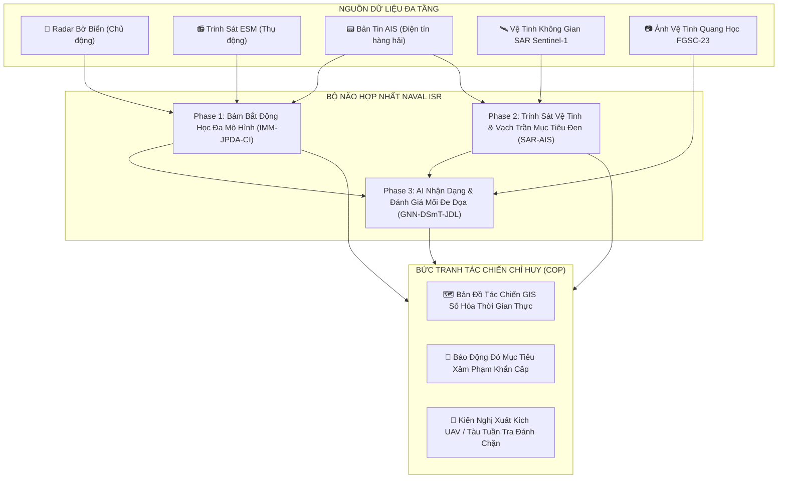
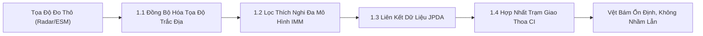
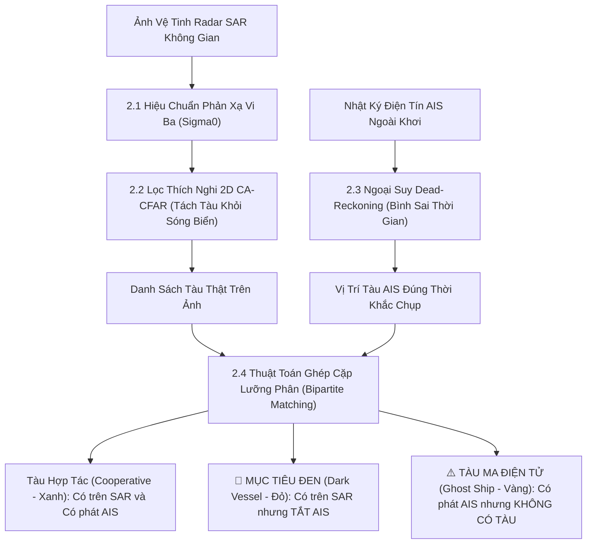
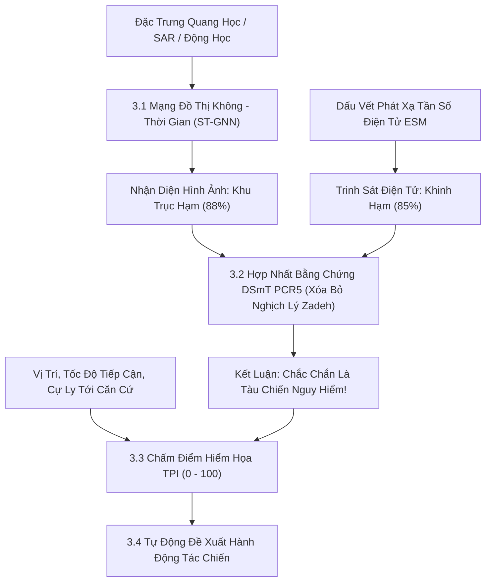

# Tổng Quan Ý Tưởng Triển Khai & Luồng Hoạt Động Hệ Thống Naval ISR
**Dự án:** Multi-Source Naval Intelligence, Surveillance & Reconnaissance Data Fusion  
**Mục tiêu tài liệu:** Trình bày toàn bộ ý tưởng kiến trúc, bối cảnh bài toán và luồng vận hành cốt lõi theo cách tiếp cận trực quan, dễ hiểu, tập trung làm rõ **ý nghĩa thực tế của từng bước xử lý** trong tác chiến và trinh sát biển (không đi sâu vào các công thức toán học phức tạp).

---

## 1. Bối Cảnh & Ý Tưởng Cốt Lõi Của Dự Án

### 1.1. Thách thức thực tế trong trinh sát và bảo vệ chủ quyền biển
Vùng biển và thềm lục địa của một quốc gia có diện tích hàng trăm nghìn kilomet vuông. Việc phát hiện, theo dõi và quản lý mọi mục tiêu trên biển đối mặt với nhiều khó khăn:
- **Tầm nhìn hạn chế:** Sương mù, mưa bão, sóng lớn và đêm tối làm vô hiệu hóa các phương tiện quan sát mắt thường.
- **Mục tiêu cố tình ẩn mình (Mục tiêu đen - Dark Vessels):** Tàu chiến đối phương, tàu ngầm nổi, tàu xâm phạm chủ quyền hay tàu buôn lậu thường **tắt hoàn toàn hệ thống nhận dạng tự động AIS (Automatic Identification System)** nhằm "tàng hình" trước các cơ quan quản lý hàng hải.
- **Nghi binh và đánh lừa điện tử (AIS Spoofing / Ghost Ships):** Đối phương sử dụng thiết bị phát sóng giả lập tọa độ tàu trên biển (tàu ma) để làm quá tải hệ thống giám sát, đánh lạc hướng phán đoán của sở chỉ huy.
- **Sự cơ động phức tạp:** Tàu quân sự cơ động linh hoạt, thường xuyên đổi hướng, tăng giảm tốc đột ngột, ẩn nấp trong các luồng hàng hải thương mại đông đúc.

### 1.2. Hạn chế của các cảm biến đơn lẻ
Trong thực tế tác chiến, **không có một loại cảm biến đơn lẻ nào là hoàn hảo**:
1. **Radar chủ động bờ biển:** Bám bắt mục tiêu liên tục theo thời gian thực rất tốt, nhưng khi phát sóng sẽ bị đối phương định vị trạm bờ, dễ bị gây nhiễu điện tử và bị che khuất bởi đường cong cong của Trái Đất ở cự ly xa.
2. **Thiết bị trinh sát điện tử thụ động (ESM):** Chỉ "nghe" sóng vô tuyến/radar đối phương phát ra (hoàn toàn giữ bí mật vị trí trạm nhà), nhưng không xác định được trực tiếp khoảng cách nếu mục tiêu giữ im lặng vô tuyến (chế độ EMCON).
3. **Bản tin định danh AIS:** Cung cấp đầy đủ tên tàu, quốc tịch, loại tàu, nhưng phụ thuộc hoàn toàn vào sự "tự nguyện" của tàu đó.
4. **Vệ tinh Radar khẩu độ tổng hợp (SAR):** Nhìn xuyên mây đêm ngày từ quỹ đạo không gian bao quát hàng nghìn kilomet vuông, nhưng mỗi ngày chỉ bay qua chụp được 1-2 lần, không thể bám bắt mục tiêu di động từng giây một.

### 1.3. Ý tưởng đột phá: "Hợp Nhất Đa Tầng Cảm Biến"
Ý tưởng trung tâm của dự án là **xây dựng một hệ thống hợp nhất thông tin đa nguồn (Multi-Source Data Fusion)**, lấy điểm mạnh của cảm biến này để bù đắp điểm mù của cảm biến khác. Hệ thống kết nối đồng bộ 3 tầng không gian:
- **Tầng 1 (Trạm bờ):** Radar bờ biển + Trinh sát điện tử ESM + Bộ thu AIS $\rightarrow$ Giám sát liên tục thời gian thực trong cự ly 30 - 50 km.
- **Tầng 2 (Không gian vũ trụ):** Vệ tinh viễn thám SAR + Điện tín AIS toàn cầu $\rightarrow$ Trinh sát tầm xa ngoài khơi hàng trăm kilomet, "vạch trần" các tàu tắt AIS.
- **Tầng 3 (Sở chỉ huy thông minh):** Trí tuệ nhân tạo (AI GNN) + Lý thuyết hợp nhất DSmT + Đánh giá nguy cơ tự động JDL $\rightarrow$ Tự động xếp hạng mối đe dọa và tham mưu hành động tác chiến cho người chỉ huy.

---

## 2. Luồng Hoạt Động Chính & Ý Nghĩa Thực Tế Từng Bước

Hệ thống vận hành qua một chuỗi xử lý khép kín gồm 3 giai đoạn tác chiến. Dưới đây là ý nghĩa và bản chất thực tế của từng bước:

---

### GIAI ĐOẠN 1: HỢP NHẤT DỮ LIỆU CẢM BIẾN BỜ BIỂN (TACTICAL COASTAL TRACKING)
*Mục tiêu:* Tạo ra vệt bám bắt động học ổn định, chính xác của mọi phương tiện đang di chuyển trong vùng biển ven bờ, bất kể thời tiết xấu hay mục tiêu cơ động né tránh.

#### Bước 1.1: Đồng bộ hóa không gian và thời gian đa cảm biến
- **Vấn đề thực tế:** Radar quét theo góc phương vị và cự ly, camera trinh sát xuất ra tọa độ điểm ảnh (pixel), còn máy thu AIS lại phát tọa độ kinh - vĩ độ GPS toàn cầu. Mỗi cảm biến dùng một "ngôn ngữ" tọa độ khác nhau.
- **Ý nghĩa bước này:** Chuyển đổi mọi tín hiệu thô về cùng một **hệ tọa độ phẳng cục bộ (ENU - East-North-Up)** lấy trạm bờ làm gốc. Nhờ đó, máy tính có thể đặt mọi tín hiệu lên cùng một mặt phẳng tác chiến duy nhất để so khớp chính xác.

#### Bước 1.2: Lọc bám bắt thích nghi đa mô hình (IMM - Interacting Multiple Model)
- **Vấn đề thực tế:** Tàu chở hàng dân sự thường đi thẳng với tốc độ đều. Ngược lại, tàu chiến hoặc xuồng cao tốc đổ bộ sẽ bẻ lái gắt, lượn sóng hoặc tăng tốc bất ngờ để né tránh hỏa lực. Nếu bộ lọc chỉ giả định tàu đi thẳng, khi tàu bẻ lái sẽ lập tức bị "mất dấu" (lost track).
- **Ý nghĩa bước này:** Hệ thống duy trì song song 2 mô hình chuyển động:
  1. *Mô hình chạy thẳng đều (Constant Velocity):* Dành cho trạng thái hành trình bình thường.
  2. *Mô hình ngoặt lái có phối hợp (Coordinated Turn):* Dành cho trạng thái cơ động bẻ lái khẩn cấp.
  Hệ thống tự động chấm điểm xác suất: khi thấy tàu bắt đầu đổi hướng, nó tự động dồn trọng số sang mô hình bẻ lái để bám chặt mục tiêu mà không bị trễ hoặc văng vệt bám.

#### Bước 1.3: Liên kết dữ liệu chủ động - thụ động (Active-Passive JPDA)
- **Vấn đề thực tế:** Khi hai tàu đi cắt qua nhau, hoặc khi đối phương thả mồi bẫy gây nhiễu, màn hình radar sẽ hiện lên nhiều chấm tín hiệu nằm sát nhau. Làm sao để biết chấm nào là của tàu nào?
- **Ý nghĩa bước này:** Thay vì đoán mò, hệ thống tính toán xác suất liên kết đa mục tiêu (JPDA), kết hợp cả tín hiệu bức xạ điện tử (ESM) mà tàu đó phát ra. Nhờ vậy, ngay cả khi hai tàu đi giao cắt nhau, hệ thống vẫn nhận diện chính xác danh tính của từng tàu, không bị hoán đổi mục tiêu.

#### Bước 1.4: Hợp nhất ước lượng đa trạm bằng phép giao hiệp phương sai (Covariance Intersection - CI)
- **Vấn đề thực tế:** Khi bờ biển có 2 hoặc 3 trạm radar cùng quan sát một mục tiêu, nếu cộng gộp dữ liệu một cách ngây thơ, hệ thống sẽ rơi vào trạng thái "tự tin thái quá" (Overconfidence) do các trạm đều chịu chung một số nguồn nhiễu thời tiết biển.
- **Ý nghĩa bước này:** Thuật toán CI gộp thông tin từ các trạm khác nhau với nguyên tắc toán học an toàn tuyệt đối: Giữ lại phần thông tin chắc chắn nhất, loại bỏ phần không chắc chắn, tạo ra độ chính xác vị trí cao nhất có thể mà không bị sai lệch số liệu.

---

### GIAI ĐOẠN 2: TRINH SÁT VỆ TINH & VẠCH TRẦN MỤC TIÊU ĐEN (SPACEBORNE RECONNAISSANCE)
*Mục tiêu:* Mở rộng tầm quan sát ra toàn bộ vùng biển đặc quyền kinh tế (EEZ) ngoài khơi xa, phát hiện các tàu chiến cố tình tắt AIS hoặc các thủ đoạn phát tín hiệu giả mạo.

#### Bước 2.1: Hiệu chuẩn phản xạ vi ba vệ tinh SAR (Radiometric Calibration)
- **Vấn đề thực tế:** Vệ tinh SAR chụp ảnh bằng cách bắn sóng radar xuống biển và thu sóng phản xạ về. Điểm ảnh ban đầu chỉ là các con số thô (Digital Numbers).
- **Ý nghĩa bước này:** Chuyển đổi con số thô thành thông số vật lý thực tế (Hệ số tán xạ ngược $\sigma_0$ tính bằng decibel - dB). Kim loại vỏ tàu phản xạ sóng radar cực mạnh, trong khi mặt nước biển phản xạ sóng đi hướng khác. Bước này làm sáng bừng các mục tiêu kim loại trên nền tối của biển.

#### Bước 2.2: Thuật toán lọc mục tiêu thích nghi trên nền biển động (2D CA-CFAR)
- **Vấn đề thực tế:** Mặt biển không bao giờ phẳng lặng mà luôn có sóng dập dềnh tạo ra nhiễu (clutter), thậm chí có sóng bạc đầu dễ bị nhận nhầm thành tàu nhỏ.
- **Ý nghĩa bước này:** Thuật toán CA-CFAR không áp dụng một ngưỡng cứng cho toàn bộ bức ảnh, mà nó liên tục "đo độ ồn của vùng biển xung quanh" từng điểm ảnh. Ở vùng biển động mạnh, ngưỡng tự nâng cao; ở vùng biển êm, ngưỡng tự hạ thấp. Nhờ đó, nó bắt trúng mọi con tàu mà **triệt tiêu hoàn toàn các báo động giả do sóng biển**.

#### Bước 2.3: Ngoại suy động học Dead-Reckoning (Đồng bộ thời gian lệch pha)
- **Vấn đề thực tế:** Vệ tinh bay qua chụp bức ảnh vào đúng giây thứ $T$. Nhưng bản tin AIS của tàu thuyền thì phát không liên tục (có tàu phát cách đây 2 phút, có tàu phát cách đây 5 phút). Nếu so trực tiếp tọa độ trong bản tin AIS cũ với bức ảnh SAR, hai vị trí sẽ bị lệch nhau vài kilomet do tàu vẫn đang chạy.
- **Ý nghĩa bước này:** Hệ thống lấy vận tốc (SOG) và hướng đi (COG) của tàu từ bản tin AIS cũ, áp dụng công thức đường trắc địa trên mặt cầu Trái Đất để **tính xem con tàu đó đang ở đâu vào đúng thời khắc $T$ vệ tinh chụp ảnh**. Điều này đảm bảo việc so khớp hai nguồn dữ liệu diễn ra ở cùng một tích tắc thời gian.

#### Bước 2.4: Phân loại chiến thuật mục tiêu (Dark Vessel vs Ghost Ship)
- **Ý nghĩa bước này:** Sau khi đối chiếu ảnh SAR thực tế với danh sách AIS đã bình sai thời gian, hệ thống chia toàn bộ mục tiêu trên biển thành 3 loại rõ ràng:
  1. **Tàu Hợp Tác (Cooperative - Màu Xanh Lá):** Vệ tinh thấy một khối kim loại, và hệ thống AIS có một bản tin trùng khớp. Đây là các tàu hàng, tàu chở dầu dân sự chấp hành luật pháp.
  2. **MỤC TIÊU ĐEN (Dark Vessel - BÁO ĐỘNG ĐỎ):** Vệ tinh nhìn thấy rõ một con tàu vỏ thép cỡ lớn ($\ge 50\text{ m}$), nhưng tuyệt đối **không có bất kỳ bản tin AIS nào** phát ra từ khu vực đó. Đây là dấu hiệu chắc chắn của tàu chiến xâm nhập, tàu ngầm đang đi nổi, hoặc tàu buôn lậu cố tình ngắt định vị.
  3. **TÀU MA ĐIỆN TỬ (Spoofed Ghost Ship - CẢNH BÁO VÀNG):** Trên hệ thống AIS liên tục nhận được bản tin định danh của một con tàu, nhưng ảnh chụp vệ tinh SAR xác nhận mặt biển ở đó hoàn toàn trống rỗng! Đây là thủ đoạn nghi binh tác chiến điện tử (Electronic Deception) của đối phương nhằm tạo mục tiêu giả đánh lạc hướng lực lượng phòng thủ.

---

### GIAI ĐOẠN 3: AI NHẬN DẠNG TÀU CHIẾN & ĐÁNH GIÁ MỐI ĐE DỌA (AI & THREAT ASSESSMENT)
*Mục tiêu:* Trả lời câu hỏi: "Mục tiêu đó là loại tàu gì? Có vũ khí nguy hiểm không? Mức độ đe dọa với căn cứ ven biển như thế nào và sở chỉ huy cần làm gì ngay lập tức?"

#### Bước 3.1: Nhận dạng đối tượng bằng mạng đồ thị không - thời gian (ST-GNN)
- **Vấn đề thực tế:** Một con tàu chiến trên biển không hoạt động đơn độc mà thường đi theo biên đội (tàu khu trục bảo vệ tàu sân bay, tàu quét mìn dẫn đường, v.v.). Các mô hình AI thông thường chỉ nhìn từng tàu một cách cô lập.
- **Ý nghĩa bước này:** Mạng đồ thị ST-GNN xem mỗi con tàu là một "nút" (node) và mối quan hệ cự ly, đội hình giữa chúng là các "cạnh" (edges). Nhờ kết hợp cả kích thước hình học, độ phản xạ radar và cách các tàu di chuyển tương hỗ với nhau, AI phân loại chính xác: Khu trục hạm, Khinh hạm, Tàu sân bay, Tàu ngầm hay Tàu buôn chỉ trong vài phần nghìn giây.

#### Bước 3.2: Xử lý xung đột cảm biến bằng lý thuyết Dezert-Smarandache (DSmT - Quy tắc PCR5)
- **Vấn đề thực tế (Nghịch lý Zadeh):** Trong tác chiến điện tử, đối phương có thể dùng máy phát ngụy tạo tần số vô tuyến. Ví dụ:
  - Vệ tinh nhìn thấy một con tàu dài $160\text{ m}$ $\rightarrow$ Kết luận là **Khu trục hạm (88%)**.
  - Nhưng trinh sát điện tử ESM lại thu được tần số radar phát xạ đặc trưng của một chiếc **Khinh hạm (85%)**.
  - *Nếu dùng công thức Dempster-Shafer cổ điển:* Sự xung đột gay gắt giữa 2 cảm biến sẽ dẫn đến sai lầm chết người: hệ thống triệt tiêu cả 2 nhận định và kết luận kỳ quặc rằng đây là... **Tàu buôn chở hàng** (Nghịch lý Zadeh)!
- **Ý nghĩa bước này:** Động cơ DSmT với quy tắc PCR5 tái phân phối năng lượng xung đột về đúng hai đối tượng đang tranh cãi (Khu trục hạm và Khinh hạm). Hệ thống khẳng định chắc chắn đây là một **tàu chiến quân sự có vũ trang**, dứt khoát không bị đánh lừa thành tàu dân sự vô hại.

#### Bước 3.3: Tính toán chỉ số mức độ hiểm họa (Threat Priority Index - TPI)
- **Vấn đề thực tế:** Cùng một lúc trên màn hình radar có thể xuất hiện 50 đến 100 mục tiêu. Sĩ quan chỉ huy không thể xem xét từng mục tiêu một cách thủ công.
- **Ý nghĩa bước này:** Hệ thống tự động chấm điểm nguy cơ từ 0 đến 100 cho từng mục tiêu dựa trên 4 yếu tố trọng yếu:
  1. *Bản chất mục tiêu (Lethality):* Tàu chiến mang tên lửa hành trình nguy hiểm hơn tàu hàng chở ngũ cốc.
  2. *Hành vi che giấu (Deception):* Tàu cố tình tắt AIS nguy hiểm hơn tàu khai báo công khai.
  3. *Cự ly và tốc độ tiếp cận (Proximity & Speed):* Tàu ở gần và đang chạy với tốc độ cao đe dọa lớn hơn tàu ở xa và trôi dạt.
  4. *Hình thái hướng tiếp cận (CPA / TCPA):* Con tàu đang lao thẳng mũi vào căn cứ hải quân sẽ có điểm số vọt lên cực đại so với con tàu đi ngang qua ngoài khơi.

#### Bước 3.4: Tự động đề xuất hành động tác chiến (Automated Decision Support)
- **Ý nghĩa bước này:** Chuyển đổi dữ liệu tình báo thành **hành động cụ thể** cho người chỉ huy, rút ngắn thời gian phản ứng từ hàng chục phút xuống dưới 5 giây:
  - **Điểm TPI $\ge 80$ (`CRITICAL - BÁO ĐỘNG ĐỎ`):** Tự động phát lệnh: *Xuất kích UAV trinh sát tầm trung cất cánh khẩn cấp để chiếu xạ lade và chỉ thị mục tiêu; báo động các khẩu đội tên lửa phòng thủ bờ biển*.
  - **Điểm TPI $60 - 79$ (`HIGH - CẢNH BÁO CAO`):** Tự động đề xuất: *Điều động biên đội tàu tuần tiễu cao tốc xuất bến đánh chặn và thẩm vấn*.
  - **Điểm TPI $< 40$ (`ROUTINE - THÔNG THƯỜNG`):** *Duy trì bám bắt tự động bằng radar bờ biển và lưu nhật ký hàng hải số*.

---

## 3. Bảng Tóm Tắt Ý Nghĩa Của 3 Giai Đoạn Tác Chiến

| Giai Đoạn | Câu Hỏi Cần Trả Lời | Đầu Vào Cảm Biến | Công Nghệ Cốt Lõi | Giá Trị Thực Tiễn Mang Lại |
|---|---|---|---|---|
| **Phase 1: Giám Sát Bờ Biển** | *Các tàu trong vịnh/ven bờ đang ở đâu và di chuyển như thế nào?* | Radar bờ biển, Máy thu AIS, Trinh sát điện tử ESM | IMM Filter (2 mô hình), Phân bổ xác suất JPDA, Giao hiệp phương sai CI | Không bao giờ mất vệt bám khi tàu đổi hướng gắt; không nhận nhầm tàu khi đi giao cắt nhau. |
| **Phase 2: Trinh Sát Vệ Tinh** | *Ngoài khơi xa có tàu nào cố tình ẩn nấp hoặc phát tín hiệu giả không?* | Ảnh vệ tinh Radar SAR (Sentinel-1), Bản tin AIS biển xa | Lọc thích nghi sóng biển CA-CFAR, Bình sai thời gian Dead-Reckoning | Phát hiện chính xác các mục tiêu tắt AIS (Mục tiêu đen) và vạch trần các tọa độ AIS giả mạo (Tàu ma). |
| **Phase 3: AI & Quyết Định Chỉ Huy** | *Mục tiêu đó nguy hiểm ra sao và chúng ta cần làm gì ngay lập tức?* | Đặc trưng ảnh viễn thám FGSC-23, Tín hiệu ESM, Động học | Mạng đồ thị ST-GNN, Hợp nhất DSmT PCR5, Tính chỉ số TPI | Tự động phân loại tàu chiến trong 0.2ms; chấm điểm nguy cơ (0-100) và tự động kiến nghị xuất kích lực lượng phản ứng. |

---

## 4. Minh Chứng Từ Thực Nghiệm Dữ Liệu Thật

Hệ thống đã chứng minh được tính khả thi kỹ thuật vượt trội khi kiểm thử trên dữ liệu thực tế:
1. **Chính xác và tin cậy:**
   - Trên dữ liệu Radar bờ thật (`scene01`), hệ thống bám bắt mượt mà 5 tuyến hành trình liên tục với sai số khoảng cách tập hợp đa mục tiêu chỉ **36.64 mét**.
   - Trên ảnh vệ tinh Sentinel-1 thật, hệ thống phát hiện chính xác **19 tàu thực tế** đang vượt qua Eo biển Gibraltar, phân lập thành công **11 mục tiêu đen tắt AIS** và **1 tọa độ tàu ma điện tử**.
   - Trên bộ ảnh vệ tinh FGSC-23, AI phân loại chính xác các lớp tàu chiến và loại bỏ hoàn toàn nghịch lý Zadeh khi cảm biến bị đối phương gây nhiễu mâu thuẫn.
2. **Khả năng triển khai thực tế trên phần cứng hạn chế:**
   - Toàn bộ chuỗi xử lý từ giải mã bản tin, lọc sóng biển, bám bắt động học đến suy luận AI chỉ tiêu tốn **4.94 giây trên CPU máy tính thông thường**.
   - Hệ thống **không đòi hỏi GPU đắt tiền**, mức tiêu thụ RAM dưới **300 MB**, hoàn toàn có thể nhúng trực tiếp vào các trạm radar quan sát dã chiến, tàu tuần tra cỡ nhỏ hoặc các sở chỉ huy tiền phương ven biển.

---

## 5. Kết Luận

Dự án không dừng lại ở mức mô phỏng lý thuyết mà giải quyết trực diện bài toán tác chiến biển hiện đại: **làm thế nào để người chỉ huy nhìn thấy bức tranh toàn cảnh một cách minh bạch, phát hiện kẻ địch cố tình ẩn nấp, và ra quyết định hành động trong thời gian ngắn nhất**.

Bằng việc kết hợp chặt chẽ giữa **Dữ liệu trạm bờ (Thời gian thực)**, **Vệ tinh không gian (Tầm nhìn xa)** và **Trí tuệ nhân tạo (Xử lý thông minh)**, hệ thống tạo nên một lá chắn giám sát biển vững chắc, phục vụ đắc lực cho công tác bảo vệ chủ quyền biển đảo quốc gia.
